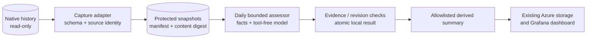

# Daily session reflection: design and rollout

The [README](README.md#architecture-today) describes the implemented architecture.
The bounded worker and reviewed publisher are implemented and fixture-tested.
The pilot is now explicitly enabled for new sessions under the approved projects
root, with its first scheduled assessment deferred until the next 09:00 local
run. First real-session capture/inference acceptance remains pending.
This document records requirements and remaining rollout gates, not a
second setup guide. Use the [operating guide](docs/session-reflection.md), track delivery in the
[pilot checklist](specs/session-reflection/tasks.md) and evidence in
[feasibility checks](SPIKES.md).

## Boundaries

| Concern | Requirement |
| --- | --- |
| Reading experience | One authenticated portal Grafana dashboard for derived assessments and metadata telemetry |
| Capture | Native local history, read-only; version-gated adapters before considering an extension |
| Eligibility | Explicit completion/archive with no active run; never infer closure from idle time, shutdown, or a finished turn |
| Cadence | Daily at 09:00 local time; catch up after sleep/login without waking the machine |
| Pilot content scope | New archived sessions under the explicitly approved projects root, including future projects; no historical backfill |
| Provider | Existing Azure GPT-5 mini deployment for the bounded pilot; full quality comparison deferred, not passed |
| Retention | Owned content: 30 days; assessments/reports: 90 days; never auto-prune native history |
| Runtime | Native macOS batch job, independent of the collector, Docker, and an open editor |
| Request bounds | 5 attempts/local day, 20,000 total request characters, 2,000 output tokens; no silent truncation or automatic failed-request retries |
| Activation | Explicit scope/preview review, inference enable and separate job installation; first scheduled run at next 09:00; results local until human-reviewed publishing |
| Unknowns | No inferred time saved, satisfaction, understanding, active effort, or productivity score |

All-project metadata collection remains separate from content analysis.
The pilot's content scope was explicitly expanded from this repository to all
new sessions under the approved projects root. Clients, directories outside that
root, machines, additional content fields, and historical
backfill need their own reviewed scope.

## Minimal pipeline

The read-only native adapter, worker, retention, schedule controls, shared
validator, and manual reviewed-summary publisher now exist. A protected local
policy limits capture to new explicitly allowlisted/root-scoped sessions; live capture/model
acceptance is still pending. Preserve the
[tested capture contract](docs/spikes/session-capture-findings.md): host IDs and
SDK IDs differ, and archive is independent of task success.

## Capture and lifecycle invariants

- Start with demonstrated local VS Code Agent Host default-chat coverage.
  Stable, desktop app, CLI, multi-chat, subagent, compacted, and remote coverage
  must not be assumed from that proof.
- Validate source/schema versions and use consistent, bounded read-only snapshots.
  Missing, partial, unsupported, or changing data must produce explicit status,
  not successful empty input.
- Bind identity to the configured project, canonical source/session ID, revision,
  versioned content digest, and rubric/model/schema versions. Include all evidence
  used by the assessment in the digest, not only user/assistant text.
- Recheck revision, archive, and active-run state before publication. Defer
  cancellation lag, pending tools, queued messages, and ambiguous activity.
- Resume invalidates eligibility. A later archived revision supersedes the
  previous result instead of counting another completion.
- Deduplicate cross-client copies only with verified canonical IDs; otherwise
  flag overlap and exclude it from totals. A session is not necessarily one task.

## Worker and data lifecycle

- Use an exclusive worker lock and persistent manifest with pending, blocked,
  running, succeeded, failed, and superseded states. Recover interrupted work.
- Write results atomically. Duplicate discovery, overlapping triggers, retries,
  and crashes must not create duplicate current results.
- Bound input size, context, daily work, retry count, inference budget, and disk
  usage. Checkpoint pending work; do not silently truncate or discard it.
- Keep no-history, no-eligible, deferred-active, unsupported-schema, blocked,
  failed, and successful states distinct. Expose last successful work, oldest
  pending item, missed runs, coverage gaps, and storage saturation.
- Keep snapshots, results, manifests, and temporary content outside Git in
  owner-only storage. Logs contain no payloads; backups have separate retention.
- Expiry is based on capture/assessment creation, not rediscovery or report render.
  Remove owned caches and excerpts too; mark expired evidence unavailable.
- Exclusion/deletion invalidates queued work and removes owned copies when
  requested, without modifying native/synced history. Do not recursively ingest
  evaluator jobs or generated reports.

## Assessment and publishing

Use the [evaluation contract](specs/session-reflection/spec.md) and
[rubric](specs/session-reflection/rubric.md). Compute deterministic facts first;
then call a bounded model with no tools. Treat transcript instructions as data.
Every claim needs existing evidence, explicit uncertainty, and model/rubric
provenance. Passing tests is narrow evidence, not proof of the user's whole goal.

Keep detailed evidence local. Publish only reviewed, allowlisted derived fields;
never prompts, replies, code, tool payloads, or evidence excerpts. A typed string
column is not a semantic redactor. The real publisher accepts a separately
human-reviewed summary, revalidates the input revision and evidence, and never
copies raw model prose automatically. Its string/key checks are not a general
semantic redactor. Published rows describe historical archived revisions;
later resumes invalidate local current status, not existing Azure rows.

## Telemetry remains independent

The existing collector filters before its bounded disk queue. It does not yet
prove native project identity or accounting, and it cannot recover records never
received while stopped. Queue saturation, disk failures, permanent errors, and
in-flight crashes are loss windows; retry/replay can duplicate records.

Before adding usage totals:

1. Verify native metadata on controlled clients and choose one accounting layer.
2. Resolve project identity before storage, never from a global active-project
   label, timestamp guess, or query-time session-mapping join.
3. Keep missing identity explicitly unattributed; remove raw paths/URLs.
4. Reconcile two concurrent projects, duplicate folder names, parent/subagent
   overlap, branch/resume cases, and replay without inflating totals.

The assessment worker's explicit workspace allowlist does not establish a native
telemetry record's source identity. Collector availability, Azure delivery, and queue safety
are separate health states. Broader rollout still needs live crash/replay,
authentication-expiry, saturation/rejection, and least-privilege access tests.
