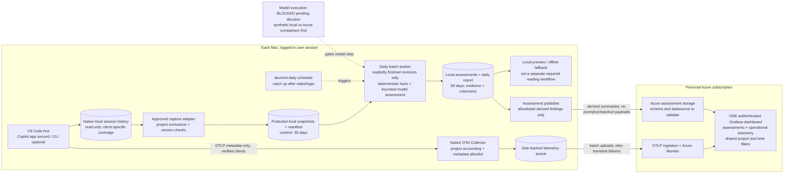

# Personal Copilot reflection and observability

**Status: direction approved for bounded development and synthetic evaluation.
Real-content inference and deployment remain separately approval-gated.**

This plan supersedes the telemetry-first proposal. The main goal is a passive,
daily reflection on coding-agent work, starting with new sessions on this Mac.
Telemetry is a separate supporting pipeline, not a proxy for productivity.
VS Code Insiders metadata export is now configured application-wide, with
content/identity capture off; activation requires a window reload and a real
native-record check. The repo's `azd` template
has deployed the Entra-authenticated monitoring baseline and initial portal
Grafana panels, without dedicated Managed Grafana. One synthetic Azure model
smoke request succeeded; the publisher is synthetic-only. A native macOS collector
and Entra-only OTLP path now pass synthetic filtering and Azure query-back checks.
Browser rendering is user-verified. Native accounting/attribution, read-only
archived-session capture, and scheduling remain pending. Metadata collection is
approved for all projects; Azure content analysis is approved only for new
`personal/copilot-otel` archived sessions at 09:00 local time, with no backfill.
That approval does not mean the daily worker is installed.
See the [pilot checklist](specs/session-reflection/tasks.md) and
[Azure setup checklist](docs/azure-setup.md). The working-pilot rollout uses basic
connection checks first; the larger model comparison is deferred, not passed.

Feasibility work is defined in [SPIKES.md](SPIKES.md). S1/S2 have scoped
[synthetic VS Code findings](docs/spikes/session-capture-findings.md): local
capture and explicit archive work. Restart/concurrency remain implementation
acceptance tests rather than make-or-break feasibility blockers.
Implementation remains gated on demonstrated feasibility, not documentation alone.

## 1. Purpose and boundaries

Answer questions such as:

- What kinds of work did I attempt, and what evidence exists of progress?
- Where did assistance work well, require corrections, or leave unresolved work?
- Which avoidable patterns recur, and what one change should I try next?
- How do these patterns differ by project and task type over time?

Prioritize VS Code Stable/Insiders, then the GitHub Copilot desktop app, with CLI
as an optional third source. Do not require daily journaling, CLI use, a manual
export after every conversation, or a new chat interface.

This is not a DORA implementation, employee score, or single productivity index.
Session length, tokens, silence after an answer, and agent claims do not prove
success, active effort, satisfaction, understanding, or time saved. Keep those
unknown unless there is appropriate evidence. A session can contain several tasks;
a task can span sessions. Do not equate session counts with completed tasks.

## 2. Decisions at a glance

| Concern | Proposed decision |
| --- | --- |
| Primary experience | One authenticated Grafana dashboard combining derived assessments and OTel telemetry, with shared project/time filters. Read whenever useful; daily analysis does not require daily reading. |
| Repository ownership | `copilot-otel` owns capture adapters, batch assessment, local data lifecycle, and telemetry. `agent-box` owns reusable skills, agents, and personal hook registration. |
| Capture | Reuse native local history first. Prove coverage and lifecycle semantics before choosing any adapter or editor extension. |
| Eligible sessions | **User-selected:** explicit completion/archive only; defer sessions without reliable evidence. No idle-time closure heuristic. |
| Analysis cadence | Once daily, off the interactive path; process only eligible, changed session revisions and catch up after sleep/login. |
| Inference | **User-selected:** undecided and blocked for real content until a synthetic local-versus-Azure evaluation and explicit approval. |
| Retention | **User-selected:** 30 days for this system's captured content; 90 days for assessments/reports. Never automatically delete native Copilot history. |
| Privacy | Two separate boundaries: sensitive, locally approved session content for reflection; metadata-only OTel with content capture disabled. |
| Local runtime | Native macOS scheduled batch worker and independent Collector LaunchAgent. Neither depends on Docker or an open editor. |
| Telemetry backend | Azure Monitor/Application Insights and portal **Dashboards with Grafana**, subject to separate approval. No dedicated Grafana by default. |
| Telemetry delivery | Disk-backed queue, bounded storage, batching, and retries; observable loss windows, not exactly-once delivery. |
| Project accounting | Stable project identity on each accounting record before cloud storage; no session-mapping joins in dashboard queries. |
| Multiple machines | Same repo-backed setup, separate local content stores. Central metadata only initially; cross-machine content sync is not assumed. |
| Rollout | Prove primary-client capture and finished-session eligibility first. Telemetry attribution is a separate gate and cannot block useful local reflection. |

Azure managed services are an explicit exception to the earlier OSS-only backend
requirement. Local components should remain OSS. Using an Azure-hosted model is
not yet approved. Docker may be used for other work without becoming a dependency.

## 3. Architecture: two independent data paths

Editable overview: [architecture.excalidraw](docs/architecture.excalidraw).
The model's location is deliberately not drawn as a deployed service. Choosing
Azure later requires a separate model-input content-egress decision. Raw sessions
and detailed local evidence do not flow through OTel or Grafana. Only approved
derived assessment fields are published for the unified dashboard. No local observability stack, cloud collector
VM, custom dashboard app, or VS Code extension is needed by default.

## 4. Capture strategy: native first, extension only for a proven gap

### Documented capabilities versus installed-client proof

Official documentation reviewed on 2026-11-19 establishes these starting points:

| Source | Documented capability | What must be proved with synthetic sessions |
| --- | --- | --- |
| VS Code Copilot harness | Local SQLite history index, JSON chat export, and `/chronicle:standup`, `/chronicle:tips`, and other Chronicle commands in the editor | Exact installed-client storage/schema, agent/chat coverage, automatic read path, truncation/compaction, and explicit completion/archive signals |
| Copilot desktop app, local sessions | Full session records under the Copilot session-state directory and a local SQLite subset | Actual paths/configuration, format versions, archive/terminal semantics, and overlap with sessions also visible in VS Code |
| Copilot CLI | Same documented family of local records and index | Optional adapter compatibility; no dependency on interactive CLI usage |
| Cloud/remote sessions | May be queryable through synced history, depending on client and policy | No assumption of a complete local transcript; defer until a supported access path and privacy policy are approved |

The 2026-11-23 synthetic tests exercised VS Code's core Agent Host Copilot
participant. This path uses a host catalog, a per-session database with an
explicit SDK identity mapping, and native runtime event files. Archive state is
in the host catalog, not the runtime history index. See the
[tested capture contract and limitations](docs/spikes/session-capture-findings.md)
before selecting an adapter; other harnesses/client versions remain unproven.

VS Code's documented local indexing default is on and experimental history sync
default is off. App/CLI documentation describes default syncing. Do not infer this
machine's actual configuration from those defaults, and do not enable sync to solve
a capture gap without approval. Local indexing does not imply local model inference.
Native Chronicle is a useful interactive baseline, not a documented unattended,
stable-schema daily assessment API.

### Selection order and constraints

1. Prefer a supported local export/read interface that provides the required
   content and lifecycle evidence. Manual JSON export is suitable for a pilot,
   not the final passive workflow.
2. If no suitable supported interface exists, propose a narrow, read-only adapter
   for native files/SQLite. Publicly documented storage is not a stable extension
   API. Version-gate it, use consistent read-only snapshots, test fixtures, and stop
   visibly on unknown schema rather than silently producing incomplete results.
3. Use a lightweight personal hook only if it supplies missing lifecycle evidence.
   The shared Copilot harness supports VS Code/app/CLI, but event formats and
   availability must be verified per client. Hooks must not invoke inference,
   block normal work, or copy every tool payload by default.
4. Consider a small VS Code extension only if an actual capture gap has a supported
   solution, or later for report/status commands. Do not assume an extension can
   read all other participants' chats. Do not build on the deprecated Chat
   Participant API. An extension cannot provide app coverage or run while closed.

Capture only explicitly allowed projects/sources after pilot approval. Keep native
history read-only. Exclude credentials, environment dumps, attachments, unrelated
files, and full repository snapshots. Redaction reduces risk but cannot certify
that arbitrary conversations contain no secrets.

Start with user/assistant turns and minimal tool metadata. If a desired assessment
needs tool output or code, document the gap and request that specific additional
content scope. Record omitted/truncated content so conclusions reflect coverage.
Compacted history is not a complete record merely because its summary is readable.

**Gate S:** prove that a new VS Code session can be captured without recurring
manual export, linked to the right project, and distinguished as active versus
explicitly finished. Repeat for the app before claiming app coverage. If a source
offers no trustworthy completion/archive signal, its sessions remain deferred;
do not substitute an idle threshold or a model's guess.

## 5. Daily batch lifecycle

Proposed schedule: one local 03:00 run when the user session is available, with a
missed-run check at login/wake. Do not wake the machine just for assessment. Specify
and test actual LaunchAgent scheduling behavior; there is no always-on guarantee.
No requirement for VS Code, Docker, or a network connection during local capture.
Inference availability depends on the later provider choice.

1. Discover eligible sources and take consistent, bounded snapshots. Retain the
   source client/version, opaque source session ID, configured project alias,
   content digest, capture coverage, and lifecycle evidence.
2. Classify lifecycle separately from task outcome: `active`, `closed`, `archived`,
   `interrupted`, or `unknown`. A terminal reason such as error/abort is not success.
   A turn-ending `agentStop`/`Stop`, process exit, quiet period, and apparent task
   success in prose are not interchangeable with explicit session completion.
3. Select only revisions with verified completion/archive evidence and no active
   run. Preserve the completion reason and recheck revision/activity immediately
   before committing a result. Interrupted/ambiguous sessions are deferred unless
   a verified explicit completion/archive also makes them eligible.
4. Snapshot and record normalized events plus a local SQLite processing manifest.
   Use canonical source identity, content digest, and rubric/model/schema versions
   as the processing key. Do not modify the clients' databases.
5. Compute deterministic facts first, then assess bounded task segments using the
   approved model. Until inference approval, show `blocked: provider decision`;
   never pretend a report has been model-assessed.
6. Validate structured output and evidence references. Write results atomically
   and assemble one local daily report. An unchanged rerun must not double-count.
7. On resume/unarchive, invalidate that revision's eligibility. A changed revision
   can be reassessed only after new verified closure; supersede earlier results
   rather than adding a second completion. Deduplicate cross-client copies only
   with verified canonical IDs; otherwise flag overlap and exclude it from totals.

Use an exclusive worker lock and a persistent manifest with pending, blocked,
running, succeeded, failed, and superseded states. Recover interrupted work after
restart. Bound session size, model context, per-day work, retries, and model spend;
checkpoint remaining eligible work instead of dropping or silently truncating it.
Invalid output and provider errors remain visible failures, not empty successes.

Status should distinguish no history yet, no eligible sessions, deferred active
sessions, unsupported source/schema, inference blocked, assessment failure, and
successful processing. Show last successful discovery/assessment, oldest pending
item, missed runs, and disk usage. A new machine legitimately starts with no data;
do not backfill cloud/old-machine histories automatically.

## 6. Assessment contract and useful output

### Three layers, never one opaque score

| Layer | Examples | Required treatment |
| --- | --- | --- |
| Observed facts | Source timestamps, visible test command/results, corrections, referenced files/PRs | Deterministic where possible; distinguish failed commands from test failures and missing output from success |
| Model interpretations | Task type, avoidable friction, change of direction, apparent outcome | Evidence references, uncertainty/unknowns, and rubric/model/schema versions |
| Unknown without independent evidence | Time saved, understanding, satisfaction, active effort, production impact | Do not infer from tokens, elapsed time, session closure, or agent self-reports |

Each task-segment assessment records session revision, project, task/segment
boundaries, observed outcome evidence, interpretation, uncertainty, limitations,
and stable references to the local snapshot. Outcome vocabulary should distinguish
verified test evidence, agent-claimed completion, partial progress, unresolved,
and unknown. Tests passing is not proof the user's whole goal was achieved.
Do not treat legitimate scope changes or exploration as avoidable failures.

The daily report contains:

- Eligible-session count, source/project coverage, deferred/excluded counts, and
  incomplete evidence warnings.
- Work attempted and progress evidence, grouped by project and task type.
- A few evidence-backed assistance/friction patterns, including contrary examples.
- One suggested experiment or instruction change, never applied automatically.
- A clearly separated telemetry summary only where matching coverage is verified.

Start with local structured JSON and a readable Markdown preview outside Git for
the feasibility pilot. The target reading experience is one Grafana dashboard,
not separate report and telemetry destinations. No bespoke web UI or scoring dashboard initially. Assessments
must remain useful without OTel; do not make a timestamp/project guess to connect
unmatched telemetry. Optional linking requires a verified shared identifier.

### Unified Grafana reading experience

- Publish concise derived assessment summaries, friction patterns, recommendations,
  uncertainty, and coverage alongside project/model usage, latency, errors, and
  delivery health in the same dashboard. Use common project/time filters.
- Analysis runs daily; viewing is on demand over a week, month, or selected period.
  Distinguish session/work timestamps from assessment timestamps. Period totals
  must exclude superseded revisions and avoid counting daily summaries twice.
- Keep prompts, chat replies, code, tool payloads, and evidence excerpts local.
  Publish opaque evidence/session references only; local references will not
  resolve on another device. This keeps the dashboard compact as well as limiting
  content egress.
- Assessment publishing is a separate allowlisted path from metadata-only OTel.
  Both feed the same Grafana experience; they need not share an ingestion format
  or physical store. Grafana displays data rather than storing the assessments.
- Validate narrative rendering, shared filters, datasource support, retention,
  and authenticated access in the proposed Azure portal Grafana experience before
  promising that implementation. A portal limitation requires a reviewed hosting
  decision, not a silent fallback to a separate reporting application.
- Require Entra authentication and least-privilege RBAC; no anonymous sharing.
  Subscription ownership alone is not an access-control policy. Actual field
  schema, storage, permissions, and deployment costs remain approval-gated.

The assessor has no shell, file-editing, network-fetch, MCP, or deployment tools.
Only a bounded input snapshot and the chosen inference endpoint are available.
Treat transcript instructions as untrusted data, not evaluator instructions.
Use a direct inference API unless the SDK solves a demonstrated need. SDK use does
not make inference local. Exclude evaluator jobs and their usage from measured
coding sessions, and never recursively ingest generated reports.

The user deferred the full local-versus-Azure comparison in favor of a basic
working pilot. One synthetic Azure smoke and manual review are complete, not
quality certification. The existing Azure GPT-5 mini provider is now approved
only for new archived `personal/copilot-otel` sessions. Broader content rollout
still requires useful, supported conclusions rather than merely valid JSON.
Calibration needs occasional review, not daily user labeling.

## 7. Telemetry project attribution: a separate gate

### Identity model

- `project.id`: a stable, explicitly configured project alias. One project may
  include multiple repositories. Folder basename is not a unique identifier.
- `repository.id`: optional sanitized repository alias, resolved through local
  configuration. Do not retain credential-bearing remote URLs or workspace paths.
- `branch`: optional secondary dimension, not the project identifier. It describes
  the branch observed for an invocation, not every file the agent might touch.
- `machine.id`: non-personal configured alias, not a captured hostname or username.
- `client.source`: distinguish editor extension, Agent Host/runtime, and CLI as
  needed to select exactly one accounting stream.

Attribution means the configured originating project for an invocation, not a
claim that every token can be allocated to individual files or repositories an
agent subsequently reads. Multi-root workspaces require an explicit policy.

### Accounting record

Normalize an eligible native span into an accounting record, initially stored as
an attributed span rather than introducing a new database or processing service:

| Field | Purpose |
| --- | --- |
| `schema.version`, `accounting.kind` | Version and identify the selected accounting convention |
| `event.id`, timestamp | Deterministic identity for deduplication and time-window queries |
| `project.id`, `attribution.status`, `attribution.method` | Assigned alias or explicit `unattributed`, with provenance |
| `machine.id`, `client.source` | Separate clients and machines without personal identifiers |
| Trace/span IDs and conversation ID where available | Investigation and replay reconciliation; not dashboard joins |
| Input/output token counts; cache counts where supported | Quantities consumed under the verified client schema |
| Model, duration, outcome where reliable | Optional dimensions; never infer a single actual model from a mixed-model rollup |

`event.id` must be derived from stable source identifiers, such as source plus
trace/span IDs and accounting kind. Replaying a record must not give it a new ID.
Dashboard totals must deduplicate replayed accounting records without mapping joins.

### How labels reach usage records

1. Capture small, controlled metadata-only examples from each installed client.
   Record exact versions, harness, field names, units, span hierarchy, and IDs.
2. Prefer project/repository identity already carried by native accounting spans.
   Map approved native identifiers to project aliases locally, then remove raw
   paths/URLs before queueing.
3. If identity is on a top-level invocation with verified token rollups, project
   totals may use that level exclusively. Verify subagent inclusion and ensure
   editor wrapper spans and runtime spans are not both counted.
4. If only model-call spans have usable counts, they must also have trustworthy
   source identity. Parent attributes do not automatically inherit to children;
   a stateless Collector transform cannot join arbitrary spans or mapping events.
5. For CLI gaps, evaluate explicit per-process source tagging. Do not assume the
   same approach isolates VS Code windows sharing a process or Agent Host.
6. If a client cannot support reliable attribution through verified native fields
   or source-scoped configuration, stop and propose a client-specific adapter for
   approval. Do not silently add stateful correlation, time-window guessing, or
   the previous hook mapping mechanism.

Never stamp one collector-wide project or use the most recently active project.
Keep unknown usage in `unattributed`; publish coverage rather than dropping it.
Native aggregate metrics without project labels cannot supply per-project totals.
Per-model charts remain separate if model-call attribution cannot yet be proven.

**Gate T:** demonstrate two simultaneous projects with known synthetic totals,
no cross-project leakage, and exact reconciliation of attributed plus unattributed
usage. No substantial telemetry infrastructure work proceeds if this gate fails.
This gate is independent of session reflection and does not authorize content capture.

## 8. Reliable local telemetry collection without Docker

- Install a pinned, checksum-verified native collector and an explicit LaunchAgent
  under the current user. Setup must not rely on an interactive shell profile.
- Start at login and restart on process exit with throttling and bounded logs.
  KeepAlive does not detect a hung process; health checks are separate.
- Bind the receiver only to loopback. Verify the installed clients' local TLS
  requirements; use trusted certificates where required, never disable validation.
- Keep queue files, certificates, authentication material, and logs in protected
  per-user storage outside Git. Updates must preserve the queue and project map.
- Apply privacy filtering before persistence. Prefer exporter queue batching that
  persists before accumulating batches. An in-memory batch processor alone does
  not satisfy crash-durable buffering.
- Proposed initial batching: flush within 10-15 seconds or on a size threshold.
  Validate actual wire batching and ingestion latency with the pinned exporter.
- Use the native OTLP exporter with `file_storage` and a durable sending queue.
  Retry transient failures with backoff; resume after restart and reconnection.
- Set explicit queue capacity, disk monitoring, and compaction behavior. Proposed
  initial queue disk budget: 512 MiB, to be validated rather than assumed from a
  batch-count setting. Surface saturation and rejected telemetry.
- Do not assume the old Azure Monitor exporter's asynchronous SDK handoff proves
  successful Azure delivery. The chosen exporter's acknowledgement and retry
  behavior must be tested end to end.

The collector cannot recover records never received while it was stopped. SDK
buffers, queue saturation, disk failures, permanent errors, and in-flight work at
crash remain loss windows. Delivery may duplicate records. The plan promises
bounded, observable resilience, not guaranteed losslessness.

The LaunchAgent runs only while its user is logged in. Sleeping, logout, and
power-off are expected offline periods, not automatic incident conditions.

## 9. Azure telemetry: managed storage and dashboards

- Inventory existing resources read-only after approval. Keep the current
  subscription, region, deployed state, and costs unassumed until inspected.
- Prefer native OTLP ingestion, Entra authentication, and least-privilege rights
  scoped to the required ingestion resources. No credentials in tracked files.
- Choose a supported non-Azure-host authentication flow, including renewal and
  expired-login recovery. A Mac does not have Azure VM managed identity.
  Do not assume a collector container/binary inherits `az login` credentials.
- Use Application Insights orchestration for the required ingestion rules,
  endpoints, Log Analytics workspace, and metrics workspace, where supported.
  Verify schema, supported region, metric temporality, and histogram requirements.
- Use Application Insights' portal Grafana experience and compatible coding-agent
  dashboards. Validate queries against the chosen OTLP schema before importing.
- Existing Bicep always creates Managed Grafana Standard. Do not run `azd up` as
  the new design. Plan a reviewed migration: no automatic resource deletion or
  production replacement; preserve old data and rollback paths.
- No extra Grafana experience charge for the portal option does not mean a free
  pipeline. Ingestion, storage, applicable queries, and alerting can incur charges.
- Before deployment, approve region, retention, expected daily volume, and monthly
  budget. Budget alerts are notifications, not a hard spending cap.

## 10. Privacy, retention, health, and dashboards

### Two distinct privacy policies

**Telemetry:** OTel content capture stays explicitly off in every enabled client.
Allowlist metadata across span/resource attributes, metric dimensions, and events.
Strip free-text errors and exception payloads; retain error categories/counts.
Reject/drop application logs initially. No raw-payload debug exporter.

**Reflection:** native history already contains sensitive content. Copy only
approved sources/projects into protected per-user storage outside both repos;
directories should be owner-only and files owner-readable/writable only. Rely on
the approved OS disk-encryption posture, not permissions alone, for at-rest risk.
Logs must not contain payloads. Treat reports, evidence excerpts, and any index
containing conversation text as sensitive too.

Apply the approved 30-day captured-content and 90-day assessment/report limits to
all system-owned copies, caches, temporary files, and derived indexes. Do not reset
expiry merely by rediscovering unchanged content. Retention for assessments runs
from their creation, not each report render; report generation must not extend
embedded assessment retention. Document that backups have separate retention.
After content expiry, mark evidence unavailable instead of leaving apparently
working citations. Delete source excerpts copied into reports with the applicable
report expiry. Never prune the clients' native history automatically.

Before enabling capture, approve disk caps and saturation behavior; pending work
must not grow without limit. Pause capture/assessment visibly on quota failures
and show expired-before-processing counts. Deletion/exclusion must invalidate
queued work and remove this system's owned copies/results when explicitly
requested; it does not automatically delete native, synced, or backup copies.
No new GitHub sync, raw-content backup/upload, or Azure model access is implied.
Derived findings are intended for the unified private Grafana dashboard, but can
still reveal project details; approve the exact field allowlist before enabling
their publisher. No transcript/evidence excerpt export is included. Existing
client sync is a separate policy to inspect.

### Operational telemetry

Track three different health states:

| State | Evidence |
| --- | --- |
| Collector running | Native process plus loopback health response |
| Pipeline delivering | Successful exports, last accepted Azure record, authentication status |
| Buffer safe | Queue age/size/capacity, enqueue failures, dropped records, available disk |

Provide a local status command and periodic lightweight health check. Notifications
are optional, with permission checks, cooldown, and logs; they cannot be the only
failure signal. Test health recovery after wake. Cloud missing-heartbeat alerts,
if added, must account for normal laptop inactivity instead of paging on sleep.

First dashboards: tokens by project, attribution coverage, daily/model usage where
supported, slow/erroring tools, and collector health. Use direct filters and
aggregations of attributed records, not session-to-project joins per panel.
Normalize legacy/current names and units explicitly. Do not add cached subsets to
input totals, double-count parent/child spans, or present tokens/billing multipliers
as actual monetary spend.

## 11. Phased implementation and approval gates

| Phase | Deliverable | Exit condition |
| --- | --- | --- |
| 0. Review | Two-path plan, source priorities, data boundaries | Approve synthetic discovery scope; no normal-history access or settings changes |
| 1. Source proof | Synthetic VS Code fixtures, capture/lifecycle contract, source coverage table | Gate S passes for VS Code; app separately proved or explicitly deferred; adapter/extension choice reviewed |
| 2. Local batch foundation | Idempotent setup/status/pause/uninstall, protected store, manifest, scheduler, deterministic facts | Closure/resume, deduplication, interrupted runs, wake, retention, disk limits, and unsupported-schema tests pass without model inference |
| 3. Assessment evaluation | Same synthetic fixture suite against proposed local/Azure models; bounded read-only rubric | User selects provider, content scope, resource/spend bounds, and approves a small real-session pilot |
| 4. Useful daily reflection | Allowed-project pilot, local structured assessments and readable reports | Evidence/unknowns are reliable, reports are useful, and no recurring manual export is required |
| T1. Telemetry proof | Versioned accounting samples and synthetic reconciliation | Gate T passes for each claimed client; any adapter reviewed |
| T2. Native collector | Lifecycle, filtering, durable queue, controlled endpoint | Restart/wake/offline/privacy tests pass; no cloud dependency for buffering |
| T3. Azure telemetry pilot | Approved resources, auth, ingestion, portal dashboard | Costs approved; delivery, renewal, queries, accounting, and rollback verified |

Synthetic assessment evaluation may precede the local batch foundation to test
usefulness before investing in infrastructure. The telemetry track may proceed independently
after phase 0 and its own approvals; T2 depends on T1, and T3 on T2. Lack of telemetry
must not delay an otherwise working local daily report.

Discovery uses newly created synthetic sessions, not unrelated history. Real
capture, real-content inference, Azure resources, and any extension/hook installation
each need the relevant approval. Existing scripts, Bicep, and dashboards remain
legacy references until replaced in their phases. No training pipeline, always-on
LLM agent, cloud content lake, or custom VS Code UI is in the first version.

## 12. Acceptance tests

### Session reflection

1. A fresh machine produces a truthful "no history yet" state, not an empty success.
2. New VS Code sessions reach the protected store without per-session manual work;
   app/CLI coverage is claimed only after separate fixtures pass. Missing, compacted,
   and unsupported source data are explicitly reported.
3. Active sessions, stopped turns, quiet sessions, and uncertain lifecycle states
   are not assessed. Verified completion/archive allows assessment; error/abort
   reasons remain distinguishable from successful task outcomes.
4. Resuming a session during assessment prevents stale results from being published
   as current. Reclosing it supersedes its earlier revision without double-counting.
5. Duplicate discovery, cross-client views, retries, overlapping daily triggers,
   and worker crashes produce one current result per canonical revision/version.
6. Missed schedules catch up after login/wake. Provider/network failure leaves
   visible pending/failed work, bounded retries, and no fabricated assessment.
7. Synthetic evidence supports each claimed observation; unsupported success,
   time-saved, and satisfaction claims remain unknown. Scope changes and transcript
   prompt injections do not redirect the assessor or trigger tools.
8. Retention removes only system-owned data at the approved ages, includes caches
   and reports, and truthfully marks expired evidence. Exclusions, quota failure,
   and explicit deletion cannot leave hidden queued copies.
9. Inference stays blocked before approval. A synthetic forbidden marker is absent
   from telemetry queues, operational logs, and Azure storage; no real session is
   sent as part of synthetic provider evaluation.
10. Daily reports remain useful and readable in VS Code with Docker stopped,
    OTel disabled, and the editor closed during the batch job. Measure actual batch
    runtime/resource use; do not promise cost or model quality before evaluation.

### Telemetry

1. Two simultaneous projects, including duplicate folder basenames, remain isolated.
2. Branch change, resumed session, multi-root workspace, and subagent use follow the
   documented policy. Project totals reconcile exactly on synthetic accounting data.
3. Missing identity remains visible as `unattributed`; it never disappears via an
   inner join. Token totals equal attributed plus unattributed totals.
4. Offline collection, forced collector termination, restart, and reconnect preserve
   durably acknowledged test records; deterministic IDs prevent replay inflation.
   Measure and report any pre-persistence/in-flight loss window separately.
5. Docker remains stopped throughout normal collection and recovery tests.
6. A synthetic forbidden-content marker is absent from both local queue inspection
   and Azure storage. Do not use real prompts or code for privacy testing.
7. Authentication expiration, disk/queue saturation, permanent ingestion errors,
   and blocked exports are visible with a documented recovery path.
8. Reinstall/update and uninstall preserve collected data by default. A separate,
   explicitly destructive reset is never part of routine operations.
9. Dashboard time windows and totals are correct, without mapping joins. Proposed
   pilot target: project overview loads within five seconds for seven days of
   representative data; record volume and cold/warm query results.
10. Measure actual ingestion volume, cloud cost estimate, idle CPU/memory, and queue
    growth before approving wider rollout. No fixed resource estimate is assumed.

## 13. Approval record and remaining decisions

Selected during planning, not authorization to run capture or inference:

- Prioritize VS Code, then the Copilot desktop app; CLI is optional.
- Daily analysis of explicitly completed/archived sessions only; no idle heuristic.
- Keep inference blocked until synthetic local-versus-Azure evaluation.
- Retain owned content for 30 days and assessments/reports for 90 days.
- One authenticated Grafana dashboard is the target for both derived assessments
  and OTel. Analysis is daily; reading is on demand. No prompts/chats, code, tool
  payloads, or evidence excerpts are published to the dashboard's data stores.

The user has requested feasibility spikes before implementation. Their bounded
experiments, dependencies, and go/no-go criteria are in [SPIKES.md](SPIKES.md).
Start with S1/S2; no result is assumed and downstream work stops if those fail.
No Azure provisioning or telemetry re-enablement is needed for that source proof.
Real-content inference and deployment remain unapproved. Bounded development and
synthetic evaluation may begin on a feature branch.

During S1/S2 the user approved synthetic fixture creation/UI actions and confirmed
that marking sessions Done/archive fits their workflow. Local capture and
archive/resume were demonstrated. Subsequent workflow review accepted this as
technically feasible for the tested scope; restart and active-run/publication
checks move to implementation acceptance tests. Synthetic S4 evaluation is next.
The user requested that owned raw spike evidence be removed after preserving
sanitized findings; native client history is not automatically deleted.

Decisions gated until evidence is available:

- Actual client/harness coverage and completion semantics; supported interface
  versus reviewed file adapter, lifecycle hook, or minimal extension.
- Allowed projects, content fields, disk caps, backup policy, and pilot access.
- Initial inference provider/model, Azure content-egress scope if selected, rubric,
  model context/work limits, and resource/spend budget.
- Stable project aliases, including multi-root/multi-repository behavior.
- Azure telemetry subscription/region, resource reuse, retention, authentication,
  and budget after a separately approved read-only inventory.

## References and legacy material

- [VS Code local history, Chronicle, export, and sync](https://code.visualstudio.com/docs/agents/run/sessions/session-history)
- [Copilot session storage, syncing, and model access](https://docs.github.com/en/copilot/concepts/security-governance-and-network-settings/session-data)
- [Copilot app local/cloud sessions and archives](https://docs.github.com/en/copilot/how-tos/github-copilot-app/agent-sessions)
- [Shared Copilot hooks in VS Code](https://code.visualstudio.com/docs/agent-customization/hooks)
- [Copilot hook payloads and lifecycle](https://docs.github.com/en/copilot/reference/hooks-reference)
- [Chat Participant API deprecation and replacement options](https://code.visualstudio.com/api/extension-guides/ai/chat)
- [Azure portal Grafana experience and costs](https://learn.microsoft.com/en-us/azure/azure-monitor/app/grafana-dashboards)
- [Native Azure OTLP ingestion](https://learn.microsoft.com/en-us/azure/azure-monitor/containers/opentelemetry-protocol-ingestion)
- [Collector persistence and resiliency](https://opentelemetry.io/docs/collector/resiliency/)
- [Collector internal telemetry](https://opentelemetry.io/docs/collector/internal-telemetry/)
- [VS Code OTel schemas](https://code.visualstudio.com/docs/agents/guides/monitoring-agents)
- [Shared Copilot OTel reference](https://docs.github.com/en/copilot/reference/enterprise-administrators/opentelemetry-reference)
- [Legacy attribution design](docs/session-story-attribution-plan.md)
- [Legacy collector configuration](otel-collector-config.yaml)
- [Current infrastructure](infra/main.bicep)

Documentation describes current capabilities, not proof of installed-client
behavior. Pin tested versions and preserve evidence before accepting each gate.
