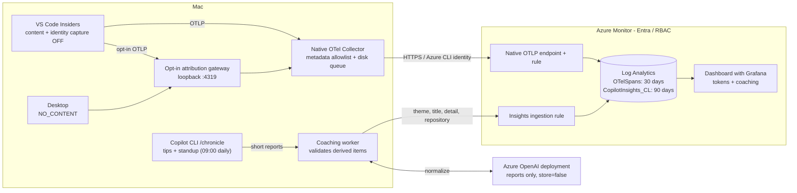

# Copilot telemetry and coaching

Metadata-only Copilot telemetry and daily Copilot coaching in one authenticated
Azure Monitor dashboard with Grafana. Native macOS collector, Python tools, and
`azd`/Bicep infrastructure. No Docker or dedicated Grafana server.

## Current status

**Working pilot.** Two independent paths feed the same dashboard:

| Path | What it does | Verified | Still pending |
| --- | --- | --- | --- |
| Telemetry | VS Code Insiders / desktop OTLP metadata → local filtering collector → Azure; exact-ID project attribution with exclusions | VS Code attribution in Azure; desktop 1.5.0 local HTTP/JSON and exact catalog-ID join | Desktop gateway/Azure acceptance; source dashboard deployment; second-project attribution; usage reconciliation; gateway restart after reboot |
| Coaching | Daily Copilot CLI `/chronicle tips` + `/chronicle standup` → Azure model normalizes the reports → `CopilotInsights_CL` | First run on 24 November 2026: 14 items published, query-verified, and returned by every coaching panel query | First scheduled 09:00 run and wake/login catch-up; trend usefulness over a few weeks |

Telemetry does not trigger coaching and coaching does not read telemetry.

## Architecture



**What crosses each boundary.** Chronicle analyses your Copilot session history
inside Copilot's own service, which already holds those sessions (VS Code Agent
Host sessions are included because they run on the Copilot CLI runtime). Only
Chronicle's short reports (about 1-2 KB each) go to your Azure model. Only
validated items are published: a fixed theme or standup status, a one-line
title, a short detail, and an optional `owner/repo`. Items containing local paths,
code fences, newlines, or secret patterns fail the whole run before upload.

## Try it locally

Requires Python 3.11+. Run from the repository root:

```bash
python3 -m venv .venv
.venv/bin/python -m pip install -r requirements.txt
.venv/bin/python -m unittest discover -s tests
```

Tests use fixtures and mocks. They do not read real history, call models, upload
data, or install services. Infrastructure tests compile Bicep if Azure CLI and
its Bicep compiler are present. Native-binary privacy and attribution tests run
only if the pinned collector is already installed.

## Deploy Azure

Follow [Azure setup](docs/azure-setup.md) for authentication, permissions, model
configuration, and acceptance checks. After `az login` and `azd auth login`:

```bash
azd env new copilot-pilot
azd env set AZURE_SUBSCRIPTION_ID <subscription-id>
azd env set AZURE_LOCATION <monitoring-region>
azd provision --preview
# Review resources, roles, region, and cost before applying:
azd provision
```

Use `azd env select` for an existing environment. Bicep creates Log Analytics,
Entra-only Application Insights, separate trace/coaching ingestion rules, a
trace collection endpoint, scoped user roles, and the dashboard definition.
Endpoints use public TLS with RBAC, not private networking. Ingestion and storage
can incur charges.

## Native macOS collector

After provisioning and signing into Azure CLI:

```bash
.venv/bin/python -m tools.native_collector install
.venv/bin/python -m tools.native_collector status
curl --fail http://127.0.0.1:13133
```

Installation downloads a pinned, SHA256-checked collector and starts a user
LaunchAgent named **Copilot Telemetry Collector**. It does not configure clients.
It runs after login; sleeping or logging out can interrupt collection.

### Connect VS Code Insiders

Use these application-wide settings only for the metadata scope you intend to
collect. They apply across projects. Agent Host and the Copilot Chat extension
have separate telemetry configuration; enabling one does not enable the other.

For **Agent Host sessions** (including Copilot SDK chats), use:

```json
{
  "chat.agentHost.otel.enabled": true,
  "chat.agentHost.otel.exporterType": "otlp-http",
  "chat.agentHost.otel.otlpEndpoint": "http://127.0.0.1:4318",
  "chat.agentHost.otel.captureContent": false,
  "chat.agentHost.otel.captureIdentity": false,
  "chat.agentHost.otel.outfile": "",
  "chat.agentHost.otel.dbSpanExporter.enabled": false
}
```

Fully quit and reopen Insiders after changing Agent Host telemetry settings;
reloading a window can leave the shared host running with its old startup
configuration. Use a new controlled session to verify delivery. These settings
cover Agent Host providers, not only the Copilot Chat extension.

For **Copilot Chat extension telemetry**, use:

```json
{
  "github.copilot.chat.otel.enabled": true,
  "github.copilot.chat.otel.exporterType": "otlp-http",
  "github.copilot.chat.otel.protocol": "http/json",
  "github.copilot.chat.otel.otlpEndpoint": "http://127.0.0.1:4318",
  "github.copilot.chat.otel.captureContent": false,
  "github.copilot.chat.otel.captureIdentity": false,
  "github.copilot.chat.otel.outfile": "",
  "github.copilot.chat.otel.dbSpanExporter.enabled": false
}
```

Run **Developer: Reload Window** after changing the extension settings, then use
a new session. Environment or enterprise settings may override either
configuration; verify actual records. CLI, Stable, and desktop clients need
separate configuration and verification.

### Check delivery and control the service

```bash
# Synthetic privacy/delivery check; no model call:
.venv/bin/python -m tools.native_collector smoke
.venv/bin/python -m tools.native_collector query-smoke <receipt-file>

.venv/bin/python -m tools.native_collector stop
.venv/bin/python -m tools.native_collector start
# Stop before reinstalling to update configuration.
.venv/bin/python -m tools.native_collector uninstall
```

If query-back is pending, retry the read, not `smoke`. Local health is not proof
of Azure delivery. State, queue, and warn/error logs are retained under
`~/Library/Application Support/copilot-otel`; inspect `logs/collector.stderr.log`
for failures. Logs are not yet rotated. Expired authentication requires `az login`.
Uninstall removes the recognized LaunchAgent, not its retained data.

### Project attribution with exclusions

The default receiver on `127.0.0.1:4318` still marks spans `unattributed`.
The local gateway on `127.0.0.1:4319` resolves exact session identities
against read-only catalogs: VS Code's native host/SDK mapping and, for version-2
discovery policies, desktop's `~/.copilot/session-store.db`. It sends
project aliases to a separate collector receiver on `127.0.0.1:4320`, which
filters before its existing disk queue. Raw workspace paths are never added to
exports. Attribution does not verify usage accounting.

Create a private JSON policy outside Git (replace these paths with full absolute
paths; JSON values do not expand `~` or environment variables):

```json
{
  "version": 2,
  "editor": "/Users/you/Library/Application Support/Code - Insiders",
  "projects_root": "/Users/you/projects",
  "excluded_workspaces": []
}
```

Eligible workspaces in either catalog are discovered automatically on each
export, without registering new projects or reinstalling the collector.
For `/Users/prasanna/projects`, a project beneath
`personal/copilot-otel` gets alias `personal/copilot-otel`, and one beneath
`msft/scb/COIN_AI_SDK` gets `msft/COIN_AI_SDK`. The first folder beneath the root
is the category and the canonical project's final folder is the project name;
intermediate folders are ignored. Conventional Git primary checkouts, their
registered linked worktrees, and ordinary repository subdirectories share the
primary checkout's alias. A nested independent repository remains a separate
project. A worktree outside `projects_root` is eligible only when reciprocal Git
registration links verify an eligible primary checkout inside the root; directory
names and remote URLs are never used to guess ownership.

Existing non-Git directories retain workspace-based naming, including subfolder
names. Projects directly beneath the root use `projects/folder-name`.
Distinct repositories or non-Git workspace paths with the same alias remain
unattributed with `identity_conflict`, rather than combining unrelated projects.
Multiple sessions and registered worktrees of one repository are allowed.
Aliases must contain two components of 1-63 ASCII letters, digits, dots,
underscores, or hyphens. Unsupported names remain unattributed; `synthetic/demo`
is reserved. Raw absolute paths are not exported, but category and project names are.
Add absolute directory paths to `excluded_workspaces` to exclude them and all
descendants. Exclusions apply to the actual session directory, its checkout root,
and the canonical primary checkout. Excluding the primary excludes all its
worktrees; excluding one worktree leaves its siblings eligible. Outside-root
absolute exclusions are supported for external worktree storage. Paths are
resolved, and an ordinary symlink escaping the root cannot gain eligibility
through worktree canonicalization.
These are **attribution exclusions**, not collection exclusions: incoming spans
still pass through as `unattributed`. Enabling telemetry remains a separate,
explicit client configuration; keep content capture off.
Version 1 policies with an explicit `projects` map retain their allowlist behavior.
They use only the VS Code catalog; version 2 reads both catalogs without a
version bump or source-registration list.
Attribution policy is independent of coaching and enables no model calls. Existing native sessions can identify
**new incoming spans**; no old telemetry or conversation history is replayed.
After updating the gateway code, restart it to use the new naming rule.
Historical records retain their original aliases.

Git resolution uses bounded, read-only local filesystem metadata, never a Git
subprocess, hooks, global config, or network lookup. Metadata and Git config
values are not exported or logged. Only user-owned metadata files/directories
without group/other write permission are accepted. There is no cross-export
cache: each export gets fresh reads, with snapshot-local reuse and consistency
checks. The catalogs are bounded at 1,000 candidates each **before** root
filtering, including unrelated local VS Code workspaces. VS Code records without
a local `file:///` project URI remain ineligible, as before. Metadata is bounded at 64
ancestor steps per workspace, 64 KiB per file, and 8 MiB read per export; an
overflow or inconsistent registration fails closed, never truncates.

Initial Git support intentionally excludes bare-common-directory worktrees,
separate-git-dir layouts, absorbed submodule gitfiles, config includes,
`core.worktree` overrides, and worktree-specific configuration. These remain
unattributed instead of falling back to a guessed parent. Missing session
directories remain `lookup_incomplete`; corrupt or concurrently changed
registration makes the batch `lookup_failed`. See
[worktree troubleshooting](docs/troubleshooting.md#git-worktree-project-rollup).
To roll out this resolver change, update the installed gateway code and restart
only the gateway. Keep the existing collector, source routes, dashboard, and
AIU/root-accounting configuration; only future `project.id` grouping changes.

After reviewing that scope, start the pipeline:

```bash
chmod 600 /absolute/path/to/attribution-policy.json
.venv/bin/python -m tools.native_collector stop
.venv/bin/python -m tools.native_collector install \
  --attribution-policy /absolute/path/to/attribution-policy.json
.venv/bin/python -m tools.attribution \
  --policy /absolute/path/to/attribution-policy.json
```

The gateway runs **in the foreground**; keep that terminal open. It is not
installed as a login service. In another terminal, check
`curl --fail http://127.0.0.1:4319/health`, then set the endpoint for the VS Code client
you enabled above to `http://127.0.0.1:4319/vscode`: use
`chat.agentHost.otel.otlpEndpoint` for Agent Host, or
`github.copilot.chat.otel.otlpEndpoint` for the extension. Fully quit and reopen
Insiders for Agent Host changes; reload the window for extension-only changes.
The health response reports `status: "ok"`, `collector: "reachable"`, and
`cloud_delivery: "not_checked"`. It checks local reachability, not Azure delivery or complete
identity coverage. Policy is loaded at gateway startup; changes to the root or exclusions require
restarting the gateway. Switching policy versions or changing a version 1
allowlist also requires reinstalling the collector with the updated policy.
The dedicated receiver trusts local processes; loopback is not an authentication
boundary against other processes/users on the same machine.

The source-prefixed endpoints are `/vscode/v1/traces` and
`/desktop/v1/traces` (and the corresponding metrics/logs routes). The gateway
strips the prefix for forwarding and overwrites `telemetry.source` with
`vscode` or `desktop` on every span, including unresolved spans. Existing
unprefixed `/v1/traces` remains supported with source `unknown`.
The label describes the **configured client ingress**, not the lookup catalog
or an authenticated origin: another local process can use the same route.
`telemetry.origin` remains `unverified_client`.

The gateway supports uncompressed OTLP HTTP/JSON, the tested local
Agent Host default-chat schemas, and desktop catalog schema 0 with
`sessions(id TEXT PRIMARY KEY, cwd TEXT, host_type TEXT, ...)`. Desktop matches
only `gen_ai.conversation.id` to a canonical UUID in `sessions.id`, for
`host_type='github'` and an eligible absolute local cwd; the desktop workspace ID
is not the runtime conversation ID. A labelled route scopes identity matching
to its client; unlabelled matches in both catalogs conflict instead of choosing.
Alias/path collisions are checked across both catalogs. Missing, unreadable,
locked, changed, or incompatible metadata fails closed with content-free warnings;
both catalogs are required for version-2 cross-source collision checks.
Each catalog is bounded to 1,000 candidate sessions; an overflow fails lookup.
It reads no conversation/event files.
Unknown, missing, conflicting, unsupported, or changing identities remain
`unattributed`, with fixed `attribution.reason` values; there is no active-project,
basename, timestamp, or parent-trace guessing. Schema/lookup failures are warned,
not silently treated as a successful lookup. Subagent, remote, multi-chat, and
other-client coverage still need controlled proof.

### Connect the desktop app

Local-only capture on **desktop 1.5.0 / runtime 1.0.115-7** verified launch
environment propagation, uncompressed HTTP/JSON delivery on 4319, and an exact
conversation-ID/catalog match. Some other spans had unknown IDs; do not infer
their projects. This does not establish full coverage or Azure delivery.
Public current documentation may require HTTPS; this tested version accepts
loopback HTTP. Reverify behavior after app/runtime updates.

Start the collector/gateway above first. Fully quit the app, then launch its
actual executable from a terminal with these child-process variables. Launching
an already-running app does not replace its runtime environment.

```bash
env -u COPILOT_OTEL_FILE_EXPORTER_PATH \
  -u OTEL_EXPORTER_OTLP_HEADERS \
  -u OTEL_EXPORTER_OTLP_TRACES_HEADERS \
  -u OTEL_EXPORTER_OTLP_METRICS_HEADERS \
  -u OTEL_EXPORTER_OTLP_LOGS_HEADERS \
  COPILOT_OTEL_ENABLED=true \
  COPILOT_OTEL_EXPORTER_TYPE=otlp-http \
  OTEL_EXPORTER_OTLP_ENDPOINT=http://127.0.0.1:4319/desktop \
  OTEL_EXPORTER_OTLP_TRACES_ENDPOINT=http://127.0.0.1:4319/desktop/v1/traces \
  OTEL_EXPORTER_OTLP_METRICS_ENDPOINT=http://127.0.0.1:4319/desktop/v1/metrics \
  OTEL_EXPORTER_OTLP_LOGS_ENDPOINT=http://127.0.0.1:4319/desktop/v1/logs \
  OTEL_EXPORTER_OTLP_PROTOCOL=http/json \
  OTEL_EXPORTER_OTLP_TRACES_PROTOCOL=http/json \
  OTEL_EXPORTER_OTLP_METRICS_PROTOCOL=http/json \
  OTEL_EXPORTER_OTLP_LOGS_PROTOCOL=http/json \
  OTEL_EXPORTER_OTLP_COMPRESSION=none \
  OTEL_EXPORTER_OTLP_TRACES_COMPRESSION=none \
  OTEL_EXPORTER_OTLP_METRICS_COMPRESSION=none \
  OTEL_EXPORTER_OTLP_LOGS_COMPRESSION=none \
  OTEL_INSTRUMENTATION_GENAI_CAPTURE_CONTENT=NO_CONTENT \
  OTEL_INSTRUMENTATION_GENAI_CAPTURE_MESSAGE_CONTENT=false \
  "/Applications/GitHub Copilot.app/Contents/MacOS/github"
```

This does not change `launchctl`, a GUI setting, or login startup. Finder/Dock
launches and app updates may not retain it. Managed policy can override runtime
settings; review effective behavior before normal forwarding. The prefixed
routes are covered by offline tests but still need real-client acceptance.
The gateway remains foreground-only.

`NO_CONTENT` is not identity suppression: `enduser.pseudo.id` was emitted in the
controlled test. The gateway receives unfiltered telemetry only in memory;
the collector removes pseudonymous/resource identities and raw paths before
its queue/upload. Project aliases and validated conversation UUIDs remain.
Stop desktop telemetry by fully quitting and reopening normally without these
variables, then verify the runtime no longer has them. Do not send synthetic
spans bearing real session IDs through the normal pipeline.

The gateway has no disk spool or automatic forwarding retries. Requests and
responses are bounded to 1 MiB, exports to 10,000 spans, and socket operations to
10 seconds. Downstream rejections/failures are reported to the client; collector
partial-success responses are preserved. Client retries can replay spans, and
stopped clients/gateways can lose telemetry. Logs contain fixed reasons/counts,
not payloads or workspace paths. Existing collector logs are not rotated.

Before claiming live support, send controlled sessions from two approved
projects, query back their exact identities/aliases and absence of paths, then
verify project filters in the deployed dashboard. Offline binary tests do not
establish real-client/Azure acceptance. The pilot's dashboard attribution
status/reason columns are deployed, read-back/query verified, and user-confirmed
visible with real attribution for `personal/copilot-otel`. Two-project acceptance
remains pending. New environments still require a separately reviewed
infrastructure deployment; installing the gateway does not deploy dashboard changes.

To disable attribution without disabling collection: restore each enabled
client's endpoint (including per-signal overrides) to `http://127.0.0.1:4318`,
restart Insiders for Agent Host changes (or reload for extension-only changes),
and relaunch desktop with the adjusted environment. Stop the gateway with Ctrl-C,
then stop/reinstall the collector without `--attribution-policy`. To disable
desktop collection entirely, quit it and reopen without the telemetry environment
as described above. Historical Azure records are unchanged.

## Reading the dashboard

```text
Input tokens | Output tokens | Cache-read tokens | Last observed span
Copilot coaching
  Latest tips (full width)
  Latest standup (full width)
  Most repeated tip theme (compact) | Tip themes over time
Observed tokens over time
Observed tokens by project
Observed AIUs and estimated usage value by project
Observed tokens by model
  > Inspect data: individual spans and client-source comparison
  > Pilot notes: privacy, accounting, and analysis scope
```

Open **Azure Monitor > Dashboards with Grafana** in the portal. The
[definition](dashboards/copilot-pilot.json) is deployed by Bicep, not imported
manually. Queries use the signed-in reader's permissions. Project accepts `*`
or an exact project ID. **Telemetry source** selects All, VS Code, Desktop, or
Unknown. Both filters apply only to telemetry panels; refresh is five minutes.
The dashboard definition must be deployed to expose the new source views; local
code changes do not update the existing Azure dashboard.

- Latest tips and standup have full-width, taller reading rows, wrapped text,
  compact metadata columns, and flexible detail columns. The repeated-theme
  card is a small secondary summary beside the theme trend, below both reports.
- Token cards, trend, and project/model tables sum reported usage from
  deduplicated `chat` spans only. These are **observed tokens, not billing or
  guaranteed complete usage**; transport loss and subagent overlap remain unverified.
- Cache-read tokens are shown separately. Missing reporting is not treated as
  zero; `MissingUsage` and `MissingCache` expose incomplete chat-span reporting.
- Direct native spans remain `unattributed` with source `unknown`; the gateway labels exact,
  approved session identities. Expand **Inspect data** for per-span diagnostics.
- Source is configured ingress, not authenticated origin. Historical/unprefixed
  exports remain `unknown` and are included under All; they are not backfilled
  as VS Code. Existing overview totals stay combined under All. The collapsed
  source table compares reported chat usage without adding overlapping tool totals.
- Coaching panels cover all projects. **Latest tips** and **Latest standup** show
  the most recent run in the selected range; **Tip themes over time** shows
  which habits keep recurring. Themes: `verification`, `planning`,
  `context_and_resume`, `prompt_clarity`, `feature_usage`, `documentation`,
  `cost_efficiency`, `privacy`, `other`.
- Queries deduplicate replayed spans and resent coaching rows before time
  filtering. Lookbacks are capped at 30 days for spans and 90 days for coaching.
- The retired `CopilotAssessments_CL` table was deleted from the pilot workspace
  on 24 November 2026; delete it manually in other older workspaces.

### Project cost versus observed usage

The token table shows reported chat usage; the separate AIU table counts
deduplicated top-level `invoke_agent` observations. **Estimated usage value
(USD) = observed AIUs x $0.01**, under the explicit modeling assumption
**1 observed AIU approximately equals 1 billing credit; not billed spend**.
This bridge is not a verified equivalence. GitHub documents
[USD 0.01 per AI credit](https://docs.github.com/en/billing/concepts/product-billing/github-copilot-billing);
the estimate excludes allowances, discounts, invoice reconciliation, Azure
coaching-model charges, and telemetry ingestion/storage. It does not extrapolate
unreported usage.

[GitHub's runtime reference](https://docs.github.com/en/copilot/reference/enterprise-administrators/opentelemetry-reference)
defines `github.copilot.cost` as a model billing multiplier, **not money**.
`github.copilot.nano_aiu` measures AI units (1 AIU = 1,000,000,000 nano AIU).
Both fields are retained only when numeric, finite, and nonnegative; integers
stay integers. Numeric strings, booleans, collections, negative values, NaN,
and infinity are removed. The finite check uses `value - value == 0`, which
rejects infinity and NaN without coercing valid integers. Multipliers are
diagnostic context, never summed as money or used to manufacture missing AIUs.

The collector derives `accounting.scope=top_level` only for `invoke_agent`
spans with the documented nonempty string `server.address` and integer
`server.port` in 1-65535. It discards both raw markers before its disk queue
and upload. Other invocations are `unknown` and excluded, including unmarked
nested subagents. A parent span ID alone does not distinguish top-level work
from nested invocations. These are unverified client reports, not authenticated
billing records; validate each client's marker/AIU semantics before relying on
its estimate. The reference covers the shared runtime, not VS Code's separate
Local agent harness. Sources that omit fields/markers remain unavailable.

`EligibleRoots`, `RootsReportingAIUs`, `MissingAIURoots`, and
`UnclassifiedInvocations` expose coverage alongside each project's partial
total; `unattributed` stays visible. Missing/all-missing AIUs are unavailable,
not zero; an explicitly reported zero remains zero. `FirstClassifiedRoot`
is the first eligible observation within the selected range. Only future
telemetry retains these fields: reinstall/restart the collector to apply the
updated filter, then deploy the dashboard. No historic backfill is possible.
Do not export the same logical invocation through multiple routes: span-ID
deduplication cannot remove independently generated duplicate spans. The
dashboard does not claim complete accounting or actual billed spend.

## Daily Copilot coaching

Requires Copilot CLI (`copilot`) signed in, Azure CLI signed in, a provisioned
environment, and the Azure model settings in `.env` (see `.env.example`).

```bash
.venv/bin/python -m tools.coaching enable --execute     # checks .env, azd outputs, copilot
.venv/bin/python -m tools.coaching run --execute        # one run now (once per local day)
.venv/bin/python -m tools.coaching verify <run-id>      # confirm rows reached Log Analytics
.venv/bin/python -m tools.coaching install --execute    # 09:00 daily job + hourly catch-up
.venv/bin/python -m tools.coaching status
```

Each run calls Chronicle twice (capped at 30 Copilot AI credits each; about
10 credits in practice) and the Azure model once. See the
[operating guide](docs/coaching.md) for limits, retention, recovery, and removal.

## Repository map

| Location | Responsibility |
| --- | --- |
| [tools/coaching.py](tools/coaching.py) | Daily Chronicle → Azure model → dashboard coaching worker |
| [tools/native_collector.py](tools/native_collector.py) | Collector install, lifecycle, and synthetic delivery checks |
| [tools/attribution.py](tools/attribution.py) | VS Code/desktop exact-ID resolver and source-labelled foreground OTLP gateway |
| [tools/native_sessions.py](tools/native_sessions.py) | Read-only VS Code session catalog lookups used by attribution |
| [tools/azure_cli.py](tools/azure_cli.py) | Shared Azure CLI REST, `.env`, and `azd` helpers |
| [collector/native-config.json](collector/native-config.json) | Trace privacy filter, authentication, durable queue |
| [infra/](infra/) | Azure resources and scoped RBAC |
| [dashboards/copilot-pilot.json](dashboards/copilot-pilot.json) | Single current dashboard |
| [tests/](tests/) | Coaching, attribution, collector, dashboard, and Bicep checks |
| [docs/](docs/) | Azure setup, coaching operations, troubleshooting |
| [SPIKES.md](SPIKES.md) | Acceptance criteria still to prove |

The earlier per-session assessment pipeline (native transcript capture, rubric,
schemas, evaluation fixtures) was replaced by Chronicle; Git history retains it.
Removing files does not remove older Azure resources. Never run `azd down` on
shared infrastructure or an environment containing a shared model.

See [CONTRIBUTING.md](CONTRIBUTING.md) and [LICENSE](LICENSE).
