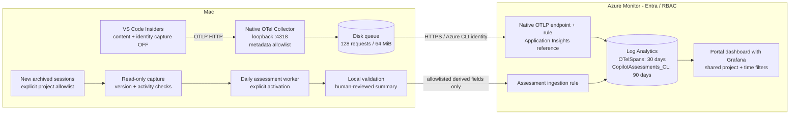
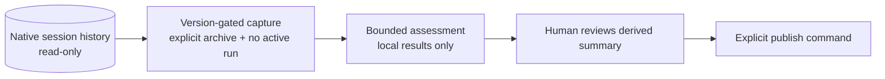

# Copilot reflection and observability

Metadata-only Copilot telemetry and evidence-backed session assessments in one
authenticated Azure Monitor dashboard with Grafana. Native macOS collector,
Python tools, and `azd`/Bicep infrastructure. No Docker or dedicated Grafana server.

## Architecture today



These are **independent paths**: telemetry does not trigger assessment. The
collector discards client logs and aggregate metrics, and strips content before
queueing traces. The real-session worker reads only new, allowlisted archived sessions; inference
and scheduling require explicit activation. Model inference uses a separately configured existing Azure
deployment; Bicep does not create or manage it.

| Available | Not yet verified or implemented |
| --- | --- |
| Read-only capture, bounded local assessment worker, retention, and schedule commands | First real-session model run and actual sleep/wake acceptance |
| Native macOS collector and synthetic privacy/query-back checks | Real-client arrival after reload; project identity and usage accounting |
| Azure infrastructure and repo-backed dashboard | Queue crash/replay durability and broader access-control tests |
| Reviewed-summary publisher and offline regression fixtures | Live real-summary query-back and full assessment-quality evaluation |

Recorded pilot checks confirm deployment and earlier dashboard rendering, not
the current live state. The latest visual refresh needs provisioning and a portal
check. Insiders metadata export was configured globally; reload and real-span
verification remain pending. See the [pilot checklist](specs/session-reflection/tasks.md).

## Try it locally

Requires Python 3.11+. Run from the repository root:

```bash
python3 -m venv .venv
.venv/bin/python -m pip install -r requirements.txt
.venv/bin/python -m unittest discover -s tests
```

Tests use authored fixtures and isolated native stores. They do not read real
history, call models, upload data, or install services. The standalone synthetic
demo and its unused folder mapper have been removed.

Infrastructure tests compile Bicep if Azure CLI is present; its Bicep compiler
must also be installed. The native-binary privacy test runs only if the pinned
collector is already installed. Neither test installs these tools for you.

## Deploy Azure

Follow [Azure setup](docs/azure-setup.md) for authentication, permissions, model
configuration, and acceptance checks. After `az login` and `azd auth login`:

```bash
azd env new copilot-pilot
azd env set AZURE_SUBSCRIPTION_ID <subscription-id>
azd env set AZURE_LOCATION <monitoring-region>
azd provision --preview
# Review resources, roles, region, and cost before applying:
azd provision
```

Use `azd env select` for an existing environment. Bicep creates Log Analytics,
Entra-only Application Insights, separate trace/assessment ingestion rules, a
trace collection endpoint, scoped user roles, and the dashboard definition.
Endpoints use public TLS with RBAC, not private networking. Ingestion and storage
can incur charges.

## Native macOS collector

After provisioning and signing into Azure CLI:

```bash
.venv/bin/python -m tools.native_collector install
.venv/bin/python -m tools.native_collector status
curl --fail http://127.0.0.1:13133
```

Installation downloads a pinned, SHA256-checked collector and starts a user
LaunchAgent named **Copilot Telemetry Collector**. It does not configure clients.
It runs after login; sleeping or logging out can interrupt collection.

### Connect VS Code Insiders

Use these application-wide settings only for the metadata scope you intend to
collect. They apply across projects:

```json
{
  "github.copilot.chat.otel.enabled": true,
  "github.copilot.chat.otel.exporterType": "otlp-http",
  "github.copilot.chat.otel.protocol": "http/json",
  "github.copilot.chat.otel.otlpEndpoint": "http://127.0.0.1:4318",
  "github.copilot.chat.otel.captureContent": false,
  "github.copilot.chat.otel.captureIdentity": false,
  "github.copilot.chat.otel.outfile": "",
  "github.copilot.chat.otel.dbSpanExporter.enabled": false
}
```

Run **Developer: Reload Window**, then use a new session. Environment or enterprise
settings may override these values; verify actual records. CLI, Stable, and desktop
clients need separate configuration and verification.

### Check delivery and control the service

```bash
# Synthetic privacy/delivery check; no model call:
.venv/bin/python -m tools.native_collector smoke
.venv/bin/python -m tools.native_collector query-smoke <receipt-file>

.venv/bin/python -m tools.native_collector stop
.venv/bin/python -m tools.native_collector start
# Stop before reinstalling to update configuration.
.venv/bin/python -m tools.native_collector uninstall
```

If query-back is pending, retry the read, not `smoke`. Local health is not proof
of Azure delivery. State, queue, and warn/error logs are retained under
`~/Library/Application Support/copilot-otel`; inspect `logs/collector.stderr.log`
for failures. Logs are not yet rotated. Expired authentication requires `az login`.
Uninstall removes the recognized LaunchAgent, not its retained data.

## Azure synthetic smoke

<details>
<summary>Optional diagnostic only; not the real-session workflow</summary>

Configure local `.env` using [.env.example](.env.example) and
[Azure setup](docs/azure-setup.md). Explicitly opt in with
`ASSESSMENT_ALLOW_SYNTHETIC_INFERENCE=true`, then:

```bash
.venv/bin/python -m tools.azure_pilot assess --execute
# Inspect the assessment; author a short derived summary, not a quotation.
.venv/bin/python -m tools.azure_pilot publish <assessment-file> \
  --summary "<reviewed synthetic summary>" --execute
.venv/bin/python -m tools.azure_pilot query <receipt-file>
```

One invocation sends one tool-free model request, with no automatic retries,
`store=false`, and at most 2,000 output tokens. Failed calls count against the
checkout-local 16-attempt ceiling. This is not a monetary cap. Generated responses,
receipts, and the budget ledger stay in ignored `.pilot/`; **do not reset the
ledger to bypass the limit**. Retry query-back rather than republishing.

</details>

## Reading the dashboard

```text
Assessed sessions | Observed spans | Model labels | Last observed span
------------------+----------------+--------------+-------------------
Activity over time                 | Observed operations
----------------------------------------------------------------------
Assessment summaries
  > Inspect data: freshness and individual spans
  > Pilot notes: privacy, accounting, and analysis scope
```

Open **Azure Monitor > Dashboards with Grafana** in the portal. The
[definition](dashboards/copilot-pilot.json) is deployed by Bicep, not imported
manually. Queries use the signed-in reader's permissions. Project accepts `*`
or an exact project ID; refresh is five minutes.

- Spans are observations, **not billable calls or token totals**. Invocation and
  model-call spans may overlap, so their tokens are not summed.
- Native spans remain `unattributed` with accounting unverified. Project filters
  cannot reconstruct missing identity.
- Queries deduplicate replayed spans and assessment revisions before time filtering.
  Lookbacks are capped at 30 days for spans and 90 days for assessments.
- Synthetic smoke records are excluded. Real assessments appear only after
  explicit reviewed-summary publishing; no data is not a health signal.
- Published assessments describe historical archived revisions, not live archive
  state. Later resumes are tracked locally, not synchronized back to Azure.

## Daily session reflection



**Implemented.** The current pilot is enabled for new sessions under the approved
projects root, including future projects. Its **Copilot Daily Session Review**
09:00 local job is installed, with
the first assessment deferred until the next 09:00 run. No immediate model call
was made. New installations start disabled; initialize their local policy once:

```bash
.venv/bin/python -m tools.session_reflection init \
  --project personal/copilot-otel=/absolute/path/to/copilot-otel
.venv/bin/python -m tools.session_reflection preview
.venv/bin/python -m tools.session_reflection status
```

Initialization fixes a no-backfill cutoff. Only sessions created afterward under
the explicit project roots can be captured. To explicitly approve an entire
projects tree in one step, including future projects:

```bash
.venv/bin/python -m tools.session_reflection configure-root \
  --projects-root /absolute/path/to/projects --execute
```

Root expansion gets its own fresh cutoff without resetting earlier approvals or
the budget. Preview prints IDs, counts, and
eligibility reasons, **not conversation text**, and makes no model calls.

The worker allows at most **5 attempts per local day**, **20,000 characters for
the entire request**, and **2,000 output tokens per request**. Oversized/uncertain
sessions are deferred; failed or interrupted attempts are not automatically
retried. Results stay local. Model limits are not a monetary cap.

After scope/preview review, activation and the optional 09:00 local job are separate
commands. See [the operating guide](docs/session-reflection.md) for activation,
reviewed publishing, stop/uninstall, retained data, and limitations. No daily
job or real-model request is enabled merely by installing this code.

## Repository map

| Location | Responsibility |
| --- | --- |
| [tools/](tools/) | Native capture, daily reflection, shared assessment validation, optional smoke tools, collector lifecycle |
| [collector/native-config.json](collector/native-config.json) | Trace privacy filter, authentication, durable queue |
| [infra/](infra/) | Azure resources and scoped RBAC |
| [dashboards/copilot-pilot.json](dashboards/copilot-pilot.json) | Single current dashboard |
| [tests/](tests/) | Assessment, attribution, collector, dashboard, and Bicep checks |
| [specs/session-reflection/](specs/session-reflection/) | Rubric, schemas, fixtures, evaluation contract, pilot checklist |

Older Docker/content-capture and branch-mapping experiments have been removed;
Git history retains them. Removing files does not remove older Azure resources.
Review those separately, and never run `azd down` on shared infrastructure or
an environment containing a shared model.

See [CONTRIBUTING.md](CONTRIBUTING.md) and [LICENSE](LICENSE).
