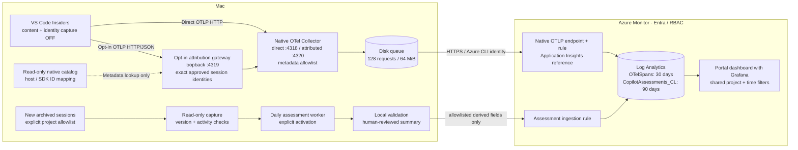

# Copilot reflection and observability

Metadata-only Copilot telemetry and evidence-backed session assessments in one
authenticated Azure Monitor dashboard with Grafana. Native macOS collector,
Python tools, and `azd`/Bicep infrastructure. No Docker or dedicated Grafana server.

## Current status

**Working pilot; live acceptance is incomplete.** Implementation and offline
regression tests are in place. Recorded Azure checks used synthetic data; they
do not establish real-client delivery, real-session assessment quality, or
current service health.

| Area | Implemented / recorded evidence | Still pending |
| --- | --- | --- |
| Session reflection | Read-only native capture, bounded worker, retention, daily scheduling, reviewed-summary publisher | First eligible real capture, assessment, and published-summary query-back |
| Metadata telemetry | Native collector and opt-in gateway started in recorded setup; metadata attribution approved for `personal/copilot-otel`; offline binary tests pass | Editor reload and controlled live two-project attribution/query-back; usage accounting |
| Azure dashboard | Attribution diagnostics deployed, definition read back, and updated query executed successfully | Verify latest rendering and portal controls |
| Assessment quality | Rubric, schemas, separate evaluation fixtures, one bounded Azure synthetic model call | Repeated scored evaluation, longer inputs, local/Azure comparison |

The last recorded pilot setup on **23 November 2026** enabled reflection for new
archived sessions under the approved projects root, including future projects,
and installed **Copilot Daily Session Review**. Its first run was scheduled for
**24 November at 09:00 local**; no real-session model request had been made.
Insiders metadata export was also configured globally, but real-span arrival
was not verified. These are recorded setup results, not a live health report.
New installations keep inference and scheduling disabled until explicitly enabled.

Azure deployment, including the last recorded dashboard refresh, was confirmed complete
on **23 November 2026**. Live acceptance checks below remain separate.

Later on **23 November**, the attribution gateway was started in the background
for `personal/copilot-otel` only, and the Insiders endpoint was saved as
`http://127.0.0.1:4319`. Content and identity capture remain off. Reload the editor
and use a controlled new session before claiming live attributed delivery.
The gateway does not restart automatically after logout/reboot.

The dashboard attribution diagnostics were updated separately and read-back/query
verified. The full `azd provision --preview` also proposed Application Insights
property changes, so that full plan was **not applied**. Only the dashboard
definition changed, preserving its portal identity and title.

### Completed implementation and recorded setup

- [x] Implement native capture, bounded reflection, retention, and reviewed-summary
  publishing; enable the pilot policy and install the daily job.
- [x] Implement native metadata filtering and disk queueing; verify synthetic
  privacy filtering and Azure query-back.
- [x] Implement opt-in exact host/SDK session attribution and bounded OTLP gateway;
  cover resolution, failure handling, and privacy with offline tests.
- [x] Start the pilot gateway for `personal/copilot-otel` and save the Insiders
  endpoint, without enabling content or identity capture.
- [x] Deploy dashboard attribution diagnostics and verify definition read-back
  and query execution.

These are implementation and recorded setup milestones, not live acceptance.

### Pending acceptance

- [ ] Inspect a new archived session's metadata-only preview, review its first
  local assessment, then publish and query back a human-reviewed derived summary.
- [ ] Verify capture identity and eligibility after a full editor/host restart,
  including cancellation, resume, and publication timing.
- [ ] Observe a real 09:00 run, sleep/wake or login catch-up, and worker recovery.
- [ ] Reload Insiders and query back real spans with exact session identities,
  approved project aliases, and no workspace paths; repeat with a second
  explicitly approved project.
- [ ] Check the deployed dashboard's rendering and project/time filters.
- [ ] Prove project identity and reconcile concurrent projects, subagent overlap,
  and replay against known totals before adding usage or delivery/error panels.
- [ ] Test queue crash/replay, offline recovery, permanent rejection, expired
  Azure CLI authentication, and saturation.
- [ ] Test a separate least-privilege reader and an unauthorized identity.
- [ ] Complete the [assessment-quality evaluation](specs/session-reflection/spec.md#frozen-evaluation-set-and-scoring-procedure)
  and longer-input tests. One synthetic result overstated evidence of a parser
  fix; successful validation is not quality certification.
- [ ] Validate other clients, multi-chat/subagent/compacted histories, remote
  sessions, and multi-machine coverage before expanding support.

See [feasibility and acceptance checks](SPIKES.md) for detailed criteria and
[capture findings](docs/spikes/session-capture-findings.md) for the tested source
contract. Usage totals and broader rollout remain deferred, not completed.

## Architecture today



These are **independent paths**: telemetry does not trigger assessment. The
collector discards client logs and aggregate metrics, and strips content before
queueing traces. The optional gateway adds only approved project aliases and
fixed attribution diagnostics; direct or unresolved spans remain `unattributed`.
Its metadata policy is separate from reflection approval and triggers no inference.
The real-session worker reads only new, allowlisted archived sessions; inference
and scheduling require explicit activation. Model inference uses a separately configured existing Azure
deployment; Bicep does not create or manage it.

## Try it locally

Requires Python 3.11+. Run from the repository root:

```bash
python3 -m venv .venv
.venv/bin/python -m pip install -r requirements.txt
.venv/bin/python -m unittest discover -s tests
```

Tests use authored fixtures and isolated native stores. They do not read real
history, call models, upload data, or install services.

Infrastructure tests compile Bicep if Azure CLI is present; its Bicep compiler
must also be installed. Native-binary privacy and attribution tests run only if the pinned
collector is already installed. Neither test installs these tools for you.

## Deploy Azure

Follow [Azure setup](docs/azure-setup.md) for authentication, permissions, model
configuration, and acceptance checks. After `az login` and `azd auth login`:

```bash
azd env new copilot-pilot
azd env set AZURE_SUBSCRIPTION_ID <subscription-id>
azd env set AZURE_LOCATION <monitoring-region>
azd provision --preview
# Review resources, roles, region, and cost before applying:
azd provision
```

Use `azd env select` for an existing environment. Bicep creates Log Analytics,
Entra-only Application Insights, separate trace/assessment ingestion rules, a
trace collection endpoint, scoped user roles, and the dashboard definition.
Endpoints use public TLS with RBAC, not private networking. Ingestion and storage
can incur charges.

## Native macOS collector

After provisioning and signing into Azure CLI:

```bash
.venv/bin/python -m tools.native_collector install
.venv/bin/python -m tools.native_collector status
curl --fail http://127.0.0.1:13133
```

Installation downloads a pinned, SHA256-checked collector and starts a user
LaunchAgent named **Copilot Telemetry Collector**. It does not configure clients.
It runs after login; sleeping or logging out can interrupt collection.

### Connect VS Code Insiders

Use these application-wide settings only for the metadata scope you intend to
collect. They apply across projects. Agent Host and the Copilot Chat extension
have separate telemetry configuration; enabling one does not enable the other.

For **Agent Host sessions** (including Copilot SDK chats), use:

```json
{
  "chat.agentHost.otel.enabled": true,
  "chat.agentHost.otel.exporterType": "otlp-http",
  "chat.agentHost.otel.otlpEndpoint": "http://127.0.0.1:4318",
  "chat.agentHost.otel.captureContent": false,
  "chat.agentHost.otel.captureIdentity": false,
  "chat.agentHost.otel.outfile": "",
  "chat.agentHost.otel.dbSpanExporter.enabled": false
}
```

Fully quit and reopen Insiders after changing Agent Host telemetry settings;
reloading a window can leave the shared host running with its old startup
configuration. Use a new controlled session to verify delivery. These settings
cover Agent Host providers, not only the Copilot Chat extension.

For **Copilot Chat extension telemetry**, use:

```json
{
  "github.copilot.chat.otel.enabled": true,
  "github.copilot.chat.otel.exporterType": "otlp-http",
  "github.copilot.chat.otel.protocol": "http/json",
  "github.copilot.chat.otel.otlpEndpoint": "http://127.0.0.1:4318",
  "github.copilot.chat.otel.captureContent": false,
  "github.copilot.chat.otel.captureIdentity": false,
  "github.copilot.chat.otel.outfile": "",
  "github.copilot.chat.otel.dbSpanExporter.enabled": false
}
```

Run **Developer: Reload Window** after changing the extension settings, then use
a new session. Environment or enterprise settings may override either
configuration; verify actual records. CLI, Stable, and desktop clients need
separate configuration and verification.

### Check delivery and control the service

```bash
# Synthetic privacy/delivery check; no model call:
.venv/bin/python -m tools.native_collector smoke
.venv/bin/python -m tools.native_collector query-smoke <receipt-file>

.venv/bin/python -m tools.native_collector stop
.venv/bin/python -m tools.native_collector start
# Stop before reinstalling to update configuration.
.venv/bin/python -m tools.native_collector uninstall
```

If query-back is pending, retry the read, not `smoke`. Local health is not proof
of Azure delivery. State, queue, and warn/error logs are retained under
`~/Library/Application Support/copilot-otel`; inspect `logs/collector.stderr.log`
for failures. Logs are not yet rotated. Expired authentication requires `az login`.
Uninstall removes the recognized LaunchAgent, not its retained data.

### Opt-in project attribution

The default receiver on `127.0.0.1:4318` still marks spans `unattributed`.
An optional local gateway on `127.0.0.1:4319` resolves exact session identities
against the read-only native catalog and persisted host/SDK ID mapping. It sends
approved aliases to a separate collector receiver on `127.0.0.1:4320`, which
filters before its existing disk queue. Raw workspace paths are never added to
exports. Attribution does not verify usage accounting.

Create a private JSON policy outside Git (replace these paths with full absolute
paths; JSON values do not expand `~` or environment variables):

```json
{
  "version": 1,
  "editor": "/Users/you/Library/Application Support/Code - Insiders",
  "projects": {
    "personal/copilot-otel": "/absolute/path/to/copilot-otel",
    "work/example": "/absolute/path/to/another-project"
  }
}
```

Only exact, explicitly approved project workspaces are eligible. Duplicate
folder names are supported; overlapping project roots and `synthetic/demo` are
rejected. Attribution policy is independent of reflection/content-analysis
approval and enables no model calls. Existing native sessions can identify
**new incoming spans**; no old telemetry or conversation history is replayed.

After reviewing that scope, opt in explicitly:

```bash
chmod 600 /absolute/path/to/attribution-policy.json
.venv/bin/python -m tools.native_collector stop
.venv/bin/python -m tools.native_collector install \
  --attribution-policy /absolute/path/to/attribution-policy.json
.venv/bin/python -m tools.attribution \
  --policy /absolute/path/to/attribution-policy.json
```

The gateway runs **in the foreground**; keep that terminal open. It is not
installed as a login service. In another terminal, check
`curl --fail http://127.0.0.1:4319/health`, then set the endpoint for the client
you enabled above to `http://127.0.0.1:4319`: use
`chat.agentHost.otel.otlpEndpoint` for Agent Host, or
`github.copilot.chat.otel.otlpEndpoint` for the extension. Fully quit and reopen
Insiders for Agent Host changes; reload the window for extension-only changes.
Health checks prove local reachability, not Azure delivery or complete
identity coverage. Policy is loaded at gateway startup; policy changes require
restarting the gateway and reinstalling the collector with the updated policy.
The dedicated receiver trusts local processes; loopback is not an authentication
boundary against other processes/users on the same machine.

This first slice supports uncompressed OTLP HTTP/JSON and the tested local
Agent Host default-chat schemas only. It reads no conversation/event files.
Unknown, missing, conflicting, unsupported, or changing identities remain
`unattributed`, with fixed `attribution.reason` values; there is no active-project,
basename, timestamp, or parent-trace guessing. Schema/lookup failures are warned,
not silently treated as a successful lookup. Subagent, remote, multi-chat, and
other-client coverage still need controlled proof.

The gateway has no disk spool or automatic forwarding retries. Requests and
responses are bounded to 1 MiB, exports to 10,000 spans, and socket operations to
10 seconds. Downstream rejections/failures are reported to the client; collector
partial-success responses are preserved. Client retries can replay spans, and
stopped clients/gateways can lose telemetry. Logs contain fixed reasons/counts,
not payloads or workspace paths. Existing collector logs are not rotated.

Before claiming live support, send controlled sessions from two approved
projects, query back their exact identities/aliases and absence of paths, then
verify project filters in the deployed dashboard. Offline binary tests do not
establish real-client/Azure acceptance. The pilot's dashboard attribution
status/reason columns are already deployed and read-back/query verified; rendering
remains pending. New environments still require a separately reviewed
infrastructure deployment; installing the gateway does not deploy dashboard changes.

To disable: restore each enabled client's endpoint to `http://127.0.0.1:4318`,
restart Insiders for Agent Host changes (or reload for extension-only changes),
stop the gateway with Ctrl-C, then stop/reinstall the collector without
`--attribution-policy`. Historical Azure records are unchanged.

## Azure synthetic smoke

<details>
<summary>Optional diagnostic only; not the real-session workflow</summary>

Configure local `.env` using [.env.example](.env.example) and
[Azure setup](docs/azure-setup.md). Explicitly opt in with
`ASSESSMENT_ALLOW_SYNTHETIC_INFERENCE=true`, then:

```bash
.venv/bin/python -m tools.azure_pilot assess --execute
# Inspect the assessment; author a short derived summary, not a quotation.
.venv/bin/python -m tools.azure_pilot publish <assessment-file> \
  --summary "<reviewed synthetic summary>" --execute
.venv/bin/python -m tools.azure_pilot query <receipt-file>
```

One invocation sends one tool-free model request, with no automatic retries,
`store=false`, and at most 2,000 output tokens. Failed calls count against the
checkout-local 16-attempt ceiling. This is not a monetary cap. Generated responses,
receipts, and the budget ledger stay in ignored `.pilot/`; **do not reset the
ledger to bypass the limit**. Retry query-back rather than republishing.

</details>

## Reading the dashboard

```text
Assessed sessions | Observed spans | Model labels | Last observed span
------------------+----------------+--------------+-------------------
Activity over time                 | Observed operations
----------------------------------------------------------------------
Assessment summaries
  > Inspect data: freshness and individual spans
      ProjectId | Attribution | AttributionReason | span metadata
  > Pilot notes: privacy, accounting, and analysis scope
```

Open **Azure Monitor > Dashboards with Grafana** in the portal. The
[definition](dashboards/copilot-pilot.json) is deployed by Bicep, not imported
manually. Queries use the signed-in reader's permissions. Project accepts `*`
or an exact project ID; refresh is five minutes.

- Spans are observations, **not billable calls or token totals**. Invocation and
  model-call spans may overlap, so their tokens are not summed.
- Direct native spans remain `unattributed`; the opt-in gateway can label exact,
  approved session identities. Accounting remains unverified. Project filters
  cannot reconstruct missing identity or relabel historical rows.
- Expand **Inspect data** to see `Attribution` and `AttributionReason` on individual
  spans. Gateway-resolved spans use `attributed` / `resolved`; unresolved gateway
  spans report a fixed reason. Direct spans do not have gateway reason diagnostics.
- Queries deduplicate replayed spans and assessment revisions before time filtering.
  Lookbacks are capped at 30 days for spans and 90 days for assessments.
- Synthetic smoke records are excluded. Real assessments appear only after
  explicit reviewed-summary publishing; no data is not a health signal.
- Published assessments describe historical archived revisions, not live archive
  state. Later resumes are tracked locally, not synchronized back to Azure.

## Daily session reflection

The worker reads only new, explicitly archived, inactive sessions from the tested
local VS Code Agent Host default-chat source. Results stay local until reviewed
and explicitly published. Initialize a new installation's policy once:

```bash
.venv/bin/python -m tools.session_reflection init \
  --project personal/copilot-otel=/absolute/path/to/copilot-otel
.venv/bin/python -m tools.session_reflection preview
.venv/bin/python -m tools.session_reflection status
```

Initialization fixes a no-backfill cutoff. Only sessions created afterward under
the explicit project roots can be captured. To explicitly approve an entire
projects tree in one step, including future projects:

```bash
.venv/bin/python -m tools.session_reflection configure-root \
  --projects-root /absolute/path/to/projects --execute
```

Root expansion gets its own fresh cutoff without resetting earlier approvals or
the budget. Preview prints IDs, counts, and eligibility reasons, **not conversation
text**, and makes no model calls.

All approved projects share **5 attempts per local day**, **20,000 characters for
the entire request**, and **2,000 output tokens per request**. Oversized or
uncertain sessions are deferred; failed or interrupted attempts are not
automatically retried. Owned snapshots expire after 30 days, results/receipts
after 90 days; reflection state is capped at 64 MiB. Native history is untouched.
These limits are not a monetary cap.

Follow [the operating guide](docs/session-reflection.md) for content scope,
explicit activation, the optional 09:00 local job, reviewed publishing, and
stop/uninstall commands. Installing the code alone enables neither inference nor
the job. Scheduling does not wake the Mac or automatically upload results.

## Repository map

| Location | Responsibility |
| --- | --- |
| [tools/](tools/) | Native capture, daily reflection, shared assessment validation, optional smoke tools, collector lifecycle |
| [tools/attribution.py](tools/attribution.py) | Opt-in metadata-only project resolver and foreground OTLP gateway |
| [collector/native-config.json](collector/native-config.json) | Trace privacy filter, authentication, durable queue |
| [infra/](infra/) | Azure resources and scoped RBAC |
| [dashboards/copilot-pilot.json](dashboards/copilot-pilot.json) | Single current dashboard |
| [tests/](tests/) | Assessment, attribution, collector, dashboard, and Bicep checks |
| [specs/session-reflection/](specs/session-reflection/) | Rubric, schemas, fixtures, and assessment evaluation contract |
| [docs/](docs/) | Azure setup, reflection operations, and capture findings |
| [SPIKES.md](SPIKES.md) | Recorded feasibility evidence and detailed acceptance criteria |

Older Docker/content-capture and branch-mapping experiments have been removed;
Git history retains them. Removing files does not remove older Azure resources.
Review those separately, and never run `azd down` on shared infrastructure or
an environment containing a shared model.

See [CONTRIBUTING.md](CONTRIBUTING.md) and [LICENSE](LICENSE).
