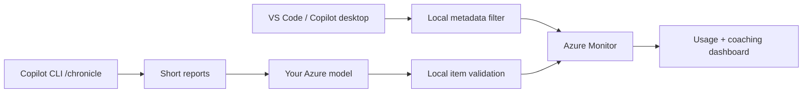

# Copilot telemetry and coaching

See how you use GitHub Copilot and get daily suggestions for working with it.
This project brings observed usage and Copilot-generated coaching into one
authenticated Azure Monitor dashboard with Grafana.

It is for individual developers who want to spot recurring habits, compare
activity across projects, and try changes to their workflow. It runs on macOS
with Python, a native OpenTelemetry collector, and your Azure subscription.
No Docker or dedicated Grafana server is needed.

## What it does

- Shows observed tokens, models, and project activity from VS Code Insiders and
  the Copilot desktop app, with optional project attribution.
- Uses Copilot CLI's `/chronicle tips` and `/chronicle standup` reports for daily
  coaching and standup summaries.
- Keeps recent reports and recurring tip themes together so you can decide
  what to change.

The two paths are independent. Use either one or both.



Coaching suggestions are prompts for reflection, not a measure of developer
performance. Their usefulness needs to be judged through regular use.

## Get started

You need macOS, Python 3.11+, Azure CLI, Azure Developer CLI (`azd`), and an Azure
subscription. Coaching also needs a signed-in Copilot CLI and an existing Azure
OpenAI deployment that supports strict JSON-schema output on the Responses API.

1. Prepare the local Python environment:
   ```bash
   python3 -m venv .venv
   .venv/bin/python -m pip install -r requirements.txt
   ```
2. Follow [Azure setup](docs/azure-setup.md) to sign in, review costs and
   permissions, and provision the dashboard and ingestion resources.
3. Enable [telemetry](docs/telemetry.md), [daily coaching](docs/coaching.md), or
   both. Each guide includes verification and stop/remove commands.
4. Open **Azure Monitor > Dashboards with Grafana** to review your activity and
   coaching.

## Privacy and cost

Telemetry keeps an allowlist of metadata before local queueing and upload;
keep client content capture off. Optional project attribution reads local
session catalogs, exports project aliases rather than paths, and leaves
unmatched sessions unattributed.

Coaching has a separate boundary: Chronicle analyzes session history through
Copilot. Its short derived reports go to **your Azure model**; only locally
validated coaching items go to Log Analytics. Reports can still contain
sensitive information, and pattern checks are not a guarantee of anonymization.
Review the [data boundaries and retention](docs/coaching.md#data-boundaries)
before enabling it.

Coaching consumes Copilot AI credits and Azure model usage. Azure ingestion and
storage also cost money. Dashboard tokens and estimated usage value are
**observations, not an invoice or guaranteed complete accounting**.

## Guides

| Guide | Use it for |
| --- | --- |
| [Azure setup](docs/azure-setup.md) | Resources, authentication, permissions, and deployment |
| [Telemetry](docs/telemetry.md) | Collector, client settings, project attribution, and dashboard interpretation |
| [Daily coaching](docs/coaching.md) | Schedule, credit limits, data handling, and upload recovery |
| [Troubleshooting](docs/troubleshooting.md) | Delivery, attribution, authentication, and failed runs |
| [Contributing](CONTRIBUTING.md) | Local tests and contribution guidelines |

[License](LICENSE) · [Code of conduct](CODE_OF_CONDUCT.md)
