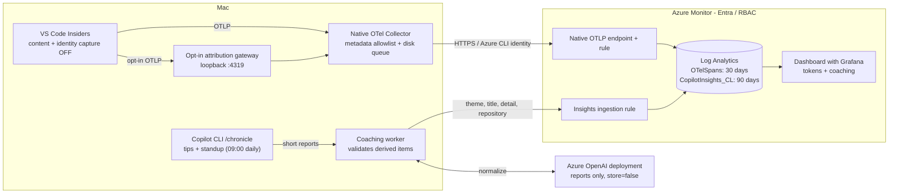

# Copilot telemetry and coaching

Metadata-only Copilot telemetry and daily Copilot coaching in one authenticated
Azure Monitor dashboard with Grafana. Native macOS collector, Python tools, and
`azd`/Bicep infrastructure. No Docker or dedicated Grafana server.

## Current status

**Working pilot.** Two independent paths feed the same dashboard:

| Path | What it does | Verified | Still pending |
| --- | --- | --- | --- |
| Telemetry | VS Code Insiders OTLP metadata → local filtering collector → Azure; optional exact-ID project attribution | Real-session spans attributed to `personal/copilot-otel` and visible in the dashboard | Second-project attribution; usage reconciliation; gateway restart after reboot |
| Coaching | Daily Copilot CLI `/chronicle tips` + `/chronicle standup` → Azure model normalizes the reports → `CopilotInsights_CL` | First run on 24 November 2026: 14 items published, query-verified, and returned by every coaching panel query | First scheduled 09:00 run and wake/login catch-up; trend usefulness over a few weeks |

Telemetry does not trigger coaching and coaching does not read telemetry.

## Architecture



**What crosses each boundary.** Chronicle analyses your Copilot session history
inside Copilot's own service, which already holds those sessions (VS Code Agent
Host sessions are included because they run on the Copilot CLI runtime). Only
Chronicle's short reports (about 1-2 KB each) go to your Azure model. Only
validated items are published: a fixed theme or standup status, a one-line
title, a short detail, and an optional `owner/repo`. Items containing local paths,
code fences, newlines, or secret patterns fail the whole run before upload.

## Try it locally

Requires Python 3.11+. Run from the repository root:

```bash
python3 -m venv .venv
.venv/bin/python -m pip install -r requirements.txt
.venv/bin/python -m unittest discover -s tests
```

Tests use fixtures and mocks. They do not read real history, call models, upload
data, or install services. Infrastructure tests compile Bicep if Azure CLI and
its Bicep compiler are present. Native-binary privacy and attribution tests run
only if the pinned collector is already installed.

## Deploy Azure

Follow [Azure setup](docs/azure-setup.md) for authentication, permissions, model
configuration, and acceptance checks. After `az login` and `azd auth login`:

```bash
azd env new copilot-pilot
azd env set AZURE_SUBSCRIPTION_ID <subscription-id>
azd env set AZURE_LOCATION <monitoring-region>
azd provision --preview
# Review resources, roles, region, and cost before applying:
azd provision
```

Use `azd env select` for an existing environment. Bicep creates Log Analytics,
Entra-only Application Insights, separate trace/coaching ingestion rules, a
trace collection endpoint, scoped user roles, and the dashboard definition.
Endpoints use public TLS with RBAC, not private networking. Ingestion and storage
can incur charges.

## Native macOS collector

After provisioning and signing into Azure CLI:

```bash
.venv/bin/python -m tools.native_collector install
.venv/bin/python -m tools.native_collector status
curl --fail http://127.0.0.1:13133
```

Installation downloads a pinned, SHA256-checked collector and starts a user
LaunchAgent named **Copilot Telemetry Collector**. It does not configure clients.
It runs after login; sleeping or logging out can interrupt collection.

### Connect VS Code Insiders

Use these application-wide settings only for the metadata scope you intend to
collect. They apply across projects. Agent Host and the Copilot Chat extension
have separate telemetry configuration; enabling one does not enable the other.

For **Agent Host sessions** (including Copilot SDK chats), use:

```json
{
  "chat.agentHost.otel.enabled": true,
  "chat.agentHost.otel.exporterType": "otlp-http",
  "chat.agentHost.otel.otlpEndpoint": "http://127.0.0.1:4318",
  "chat.agentHost.otel.captureContent": false,
  "chat.agentHost.otel.captureIdentity": false,
  "chat.agentHost.otel.outfile": "",
  "chat.agentHost.otel.dbSpanExporter.enabled": false
}
```

Fully quit and reopen Insiders after changing Agent Host telemetry settings;
reloading a window can leave the shared host running with its old startup
configuration. Use a new controlled session to verify delivery. These settings
cover Agent Host providers, not only the Copilot Chat extension.

For **Copilot Chat extension telemetry**, use:

```json
{
  "github.copilot.chat.otel.enabled": true,
  "github.copilot.chat.otel.exporterType": "otlp-http",
  "github.copilot.chat.otel.protocol": "http/json",
  "github.copilot.chat.otel.otlpEndpoint": "http://127.0.0.1:4318",
  "github.copilot.chat.otel.captureContent": false,
  "github.copilot.chat.otel.captureIdentity": false,
  "github.copilot.chat.otel.outfile": "",
  "github.copilot.chat.otel.dbSpanExporter.enabled": false
}
```

Run **Developer: Reload Window** after changing the extension settings, then use
a new session. Environment or enterprise settings may override either
configuration; verify actual records. CLI, Stable, and desktop clients need
separate configuration and verification.

### Check delivery and control the service

```bash
# Synthetic privacy/delivery check; no model call:
.venv/bin/python -m tools.native_collector smoke
.venv/bin/python -m tools.native_collector query-smoke <receipt-file>

.venv/bin/python -m tools.native_collector stop
.venv/bin/python -m tools.native_collector start
# Stop before reinstalling to update configuration.
.venv/bin/python -m tools.native_collector uninstall
```

If query-back is pending, retry the read, not `smoke`. Local health is not proof
of Azure delivery. State, queue, and warn/error logs are retained under
`~/Library/Application Support/copilot-otel`; inspect `logs/collector.stderr.log`
for failures. Logs are not yet rotated. Expired authentication requires `az login`.
Uninstall removes the recognized LaunchAgent, not its retained data.

### Opt-in project attribution

The default receiver on `127.0.0.1:4318` still marks spans `unattributed`.
An optional local gateway on `127.0.0.1:4319` resolves exact session identities
against the read-only native catalog and persisted host/SDK ID mapping. It sends
project aliases to a separate collector receiver on `127.0.0.1:4320`, which
filters before its existing disk queue. Raw workspace paths are never added to
exports. Attribution does not verify usage accounting.

Create a private JSON policy outside Git (replace these paths with full absolute
paths; JSON values do not expand `~` or environment variables):

```json
{
  "version": 2,
  "editor": "/Users/you/Library/Application Support/Code - Insiders",
  "projects_root": "/Users/you/projects",
  "excluded_workspaces": []
}
```

Local workspaces in the native session catalog beneath `projects_root` are
discovered automatically on each export, without registering new projects or
reinstalling the collector. For `/Users/prasanna/projects`, a workspace beneath
`personal/copilot-otel` gets alias `personal/copilot-otel`, and one beneath
`msft/example` gets `msft/example`. Nested workspaces share their category/project
alias; workspaces directly beneath the root use `projects/folder-name`.
Aliases must contain two components of 1-63 ASCII letters, digits, dots,
underscores, or hyphens. Unsupported names remain unattributed; `synthetic/demo`
is reserved. Raw absolute paths are not exported, but category and project names are.
Add absolute directory paths to `excluded_workspaces` to exclude them and all
descendants. Paths are resolved, so symlinks escaping the root are not eligible.
Version 1 policies with an explicit `projects` map retain their allowlist behavior.
Attribution policy is independent of coaching and enables no model calls. Existing native sessions can identify
**new incoming spans**; no old telemetry or conversation history is replayed.

After reviewing that scope, opt in explicitly:

```bash
chmod 600 /absolute/path/to/attribution-policy.json
.venv/bin/python -m tools.native_collector stop
.venv/bin/python -m tools.native_collector install \
  --attribution-policy /absolute/path/to/attribution-policy.json
.venv/bin/python -m tools.attribution \
  --policy /absolute/path/to/attribution-policy.json
```

The gateway runs **in the foreground**; keep that terminal open. It is not
installed as a login service. In another terminal, check
`curl --fail http://127.0.0.1:4319/health`, then set the endpoint for the client
you enabled above to `http://127.0.0.1:4319`: use
`chat.agentHost.otel.otlpEndpoint` for Agent Host, or
`github.copilot.chat.otel.otlpEndpoint` for the extension. Fully quit and reopen
Insiders for Agent Host changes; reload the window for extension-only changes.
The health response reports `status: "ok"`, `collector: "reachable"`, and
`cloud_delivery: "not_checked"`. It checks local reachability, not Azure delivery or complete
identity coverage. Policy is loaded at gateway startup; changes to the root or exclusions require
restarting the gateway. Switching policy versions or changing a version 1
allowlist also requires reinstalling the collector with the updated policy.
The dedicated receiver trusts local processes; loopback is not an authentication
boundary against other processes/users on the same machine.

This first slice supports uncompressed OTLP HTTP/JSON and the tested local
Agent Host default-chat schemas only. It reads no conversation/event files.
Unknown, missing, conflicting, unsupported, or changing identities remain
`unattributed`, with fixed `attribution.reason` values; there is no active-project,
basename, timestamp, or parent-trace guessing. Schema/lookup failures are warned,
not silently treated as a successful lookup. Subagent, remote, multi-chat, and
other-client coverage still need controlled proof.

The gateway has no disk spool or automatic forwarding retries. Requests and
responses are bounded to 1 MiB, exports to 10,000 spans, and socket operations to
10 seconds. Downstream rejections/failures are reported to the client; collector
partial-success responses are preserved. Client retries can replay spans, and
stopped clients/gateways can lose telemetry. Logs contain fixed reasons/counts,
not payloads or workspace paths. Existing collector logs are not rotated.

Before claiming live support, send controlled sessions from two approved
projects, query back their exact identities/aliases and absence of paths, then
verify project filters in the deployed dashboard. Offline binary tests do not
establish real-client/Azure acceptance. The pilot's dashboard attribution
status/reason columns are deployed, read-back/query verified, and user-confirmed
visible with real attribution for `personal/copilot-otel`. Two-project acceptance
remains pending. New environments still require a separately reviewed
infrastructure deployment; installing the gateway does not deploy dashboard changes.

To disable: restore each enabled client's endpoint to `http://127.0.0.1:4318`,
restart Insiders for Agent Host changes (or reload for extension-only changes),
stop the gateway with Ctrl-C, then stop/reinstall the collector without
`--attribution-policy`. Historical Azure records are unchanged.

## Reading the dashboard

```text
Input tokens | Output tokens | Cache-read tokens | Last observed span
Observed tokens over time
Observed tokens by project | Observed tokens by model
Copilot coaching
  Most repeated tip theme | Latest tips
  Tip themes over time    | Latest standup
  > Inspect data: individual spans with attribution diagnostics
  > Pilot notes: privacy, accounting, and analysis scope
```

Open **Azure Monitor > Dashboards with Grafana** in the portal. The
[definition](dashboards/copilot-pilot.json) is deployed by Bicep, not imported
manually. Queries use the signed-in reader's permissions. Project accepts `*`
or an exact project ID and applies to telemetry panels only; refresh is five minutes.

- Token cards, trend, and project/model tables sum reported usage from
  deduplicated `chat` spans only. These are **observed tokens, not billing or
  guaranteed complete usage**; transport loss and subagent overlap remain unverified.
- Cache-read tokens are shown separately. Missing reporting is not treated as
  zero; `MissingUsage` and `MissingCache` expose incomplete chat-span reporting.
- Direct native spans remain `unattributed`; the opt-in gateway labels exact,
  approved session identities. Expand **Inspect data** for per-span diagnostics.
- Coaching panels cover all projects. **Latest tips** and **Latest standup** show
  the most recent run in the selected range; **Tip themes over time** shows
  which habits keep recurring. Themes: `verification`, `planning`,
  `context_and_resume`, `prompt_clarity`, `feature_usage`, `documentation`,
  `cost_efficiency`, `privacy`, `other`.
- Queries deduplicate replayed spans and resent coaching rows before time
  filtering. Lookbacks are capped at 30 days for spans and 90 days for coaching.
- The retired `CopilotAssessments_CL` table was deleted from the pilot workspace
  on 24 November 2026; delete it manually in other older workspaces.

## Daily Copilot coaching

Requires Copilot CLI (`copilot`) signed in, Azure CLI signed in, a provisioned
environment, and the Azure model settings in `.env` (see `.env.example`).

```bash
.venv/bin/python -m tools.coaching enable --execute     # checks .env, azd outputs, copilot
.venv/bin/python -m tools.coaching run --execute        # one run now (once per local day)
.venv/bin/python -m tools.coaching verify <run-id>      # confirm rows reached Log Analytics
.venv/bin/python -m tools.coaching install --execute    # 09:00 daily job + hourly catch-up
.venv/bin/python -m tools.coaching status
```

Each run calls Chronicle twice (capped at 30 Copilot AI credits each; about
10 credits in practice) and the Azure model once. See the
[operating guide](docs/coaching.md) for limits, retention, recovery, and removal.

## Repository map

| Location | Responsibility |
| --- | --- |
| [tools/coaching.py](tools/coaching.py) | Daily Chronicle → Azure model → dashboard coaching worker |
| [tools/native_collector.py](tools/native_collector.py) | Collector install, lifecycle, and synthetic delivery checks |
| [tools/attribution.py](tools/attribution.py) | Opt-in metadata-only project resolver and foreground OTLP gateway |
| [tools/native_sessions.py](tools/native_sessions.py) | Read-only VS Code session catalog lookups used by attribution |
| [tools/azure_cli.py](tools/azure_cli.py) | Shared Azure CLI REST, `.env`, and `azd` helpers |
| [collector/native-config.json](collector/native-config.json) | Trace privacy filter, authentication, durable queue |
| [infra/](infra/) | Azure resources and scoped RBAC |
| [dashboards/copilot-pilot.json](dashboards/copilot-pilot.json) | Single current dashboard |
| [tests/](tests/) | Coaching, attribution, collector, dashboard, and Bicep checks |
| [docs/](docs/) | Azure setup, coaching operations, troubleshooting |
| [SPIKES.md](SPIKES.md) | Acceptance criteria still to prove |

The earlier per-session assessment pipeline (native transcript capture, rubric,
schemas, evaluation fixtures) was replaced by Chronicle; Git history retains it.
Removing files does not remove older Azure resources. Never run `azd down` on
shared infrastructure or an environment containing a shared model.

See [CONTRIBUTING.md](CONTRIBUTING.md) and [LICENSE](LICENSE).
