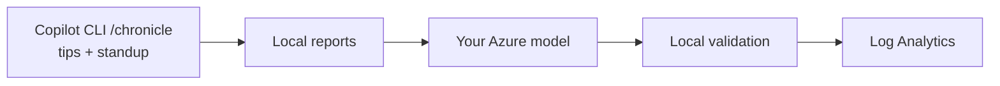

# Daily Copilot coaching

The coaching worker turns Copilot CLI's own session analysis into dashboard rows.
It never reads conversation files itself.



## Data boundaries

| Step | Sees | Leaves the Mac to |
| --- | --- | --- |
| `/chronicle tips`, `/chronicle standup` | Copilot's local session store (`~/.copilot/session-store.db`), including VS Code Agent Host sessions | Copilot's model service, which already holds those sessions |
| Normalization | Only the two Chronicle reports (~1-2 KB each) | Your Azure OpenAI deployment (`store: false`, strict JSON schema, 2,000 output tokens) |
| Publishing | Validated items only | Log Analytics `CopilotInsights_CL` via the insights ingestion rule |

Derived reports can still contain sensitive information. Pattern checks reduce
accidental exposure but do not guarantee anonymization. Local raw reports need
the same care as other session-derived material.

Chronicle runs non-interactively with `-s`, `--no-ask-user`,
`--no-custom-instructions`, `--disable-builtin-mcps`, `--sync-session=off`, and
`--max-ai-credits 30`, from an empty working directory. No `--allow-*` flags are
passed and `COPILOT_ALLOW*` variables are removed, so Copilot can only use its
default read-only session tools.

Reports containing private-key or GitHub/AWS token patterns stop before the Azure
call. Items are rejected unless they match the schema: a fixed category, a title
up to 160 characters, a detail up to 400 characters, and an empty, `owner/repo`,
or single-slug repository. Project labels with spaces are left unattributed rather
than converted to guessed repository names. The model's strict schema uses the same
length, count, and repository constraints as local validation.
Newlines, code fences, local paths, and secret patterns fail the run.
Nothing is published from a failed run.

## Setup

1. Follow [Azure setup](azure-setup.md) so the `INSIGHTS_*` outputs exist.
2. Fill the Azure model settings in `.env` from `.env.example`.
3. Sign in to `copilot`, `az`, and `azd`.

```bash
.venv/bin/python -m tools.coaching enable --execute
.venv/bin/python -m tools.coaching run --execute
.venv/bin/python -m tools.coaching verify <run-id>
.venv/bin/python -m tools.coaching install --execute
.venv/bin/python -m tools.coaching status
```

`enable` caches the ingestion endpoint, rule, and workspace IDs in the local policy
so the scheduled job does not need `azd`. Re-run it after reprovisioning.

Coaching's Azure CLI subprocesses use [a local OpenSSL configuration](../tools/coaching-openssl.cnf)
that offers conventional TLS groups with P-256 first. This avoids handshake failures
on network paths that reject OpenSSL's default hybrid key share. TLS 1.3 and
certificate verification remain enabled; hybrid post-quantum groups are not
offered by this configuration. Other jobs and Chronicle are unaffected. An explicit
`OPENSSL_CONF` environment variable takes precedence, so custom OpenSSL policies
are not overwritten.

## Schedule

The LaunchAgent **Copilot Daily Coaching**
(`~/Library/LaunchAgents/Copilot Daily Coaching.plist`) runs at 09:00 local time
and checks hourly, so a missed run catches up after wake or login. Installation
defers the first scheduled run to the next 09:00. The job does not wake the Mac.

## Limits and cost

- One attempt per local day, scheduled or manual. A failed attempt is not retried
  automatically; `run --execute --retry` spends another attempt deliberately.
- Two Chronicle calls per run, each capped at 30 Copilot AI credits.
  `status` shows recorded credits per run.
- One Azure model call per run. Actual credit and token usage varies.

Successful delivery does not establish useful advice. Review recurring themes
against your own work before treating them as habits to change.

## Recovering a failed upload

If Chronicle and the model succeeded but the upload failed, resend the validated
rows without spending more credits:

```bash
.venv/bin/python -m tools.coaching publish <run-id>
.venv/bin/python -m tools.coaching verify <run-id>
```

Dashboard queries deduplicate by `RunId`, `Kind`, and `Rank`, so a resend that
overlaps an earlier accepted upload does not double-count.

For an item-schema failure, the returned reason and local result identify the
item index, field, and failed schema rule without retaining the rejected content.
No upload receipt exists for such a failure, so `publish` cannot recover it;
after fixing the cause, `run --execute --retry` requires a new paid attempt.

## Local state and retention

State lives in `~/Library/Application Support/copilot-otel/coaching` (mode 0700):

| Path | Content | Kept |
| --- | --- | --- |
| `reports/` | Raw Chronicle reports | 30 days |
| `results/` | Validated items, credits, model token usage; content-free item-schema failure diagnostics | 90 days |
| `receipts/` | Exact rows sent and their upload status | 90 days |
| `runs.db` | One row per attempt | 90 days |
| `worker.log` | Scheduled-run JSON output (no report text) | Not rotated |

Cloud rows are retained for 90 days.

## Stop or remove

```bash
.venv/bin/python -m tools.coaching disable --execute
.venv/bin/python -m tools.coaching uninstall --execute
```

Uninstall removes the LaunchAgent and keeps local state. Delete the state folder
manually if you no longer need it.
